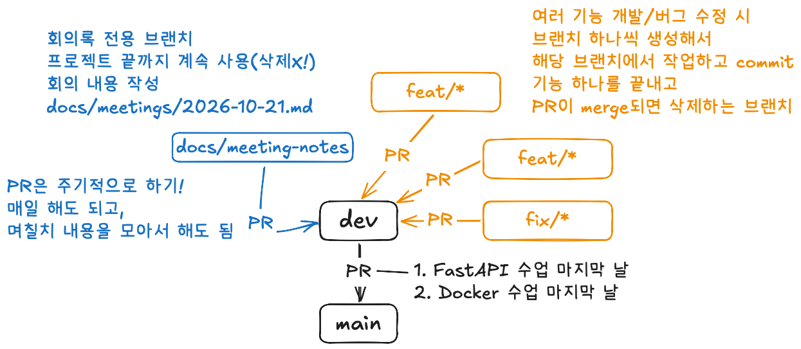

## 4조 Team Rules
### 팀원
| 이름 | GitHub ID |
| --- | --- |
| 김설아 | @seol.ditto |
| 김지수 | @soooni1229-art |
| 이지희 | @wlgml2244-jpg |
| 홍시윤 | @siyunggu |


### 팀 규칙
1. 코어 타임 : 3시 강의 종료 후 4시 중간 출결까지 **4조 소파**에서 팀플 진행
2. 1일 1커밋하기 : 잔디를 관리합시다 🌱
    - 자신의 브랜치에서 하루에 1커밋씩하고 원격 레포지토리에 푸시하기
    - 작업이 다 완료되지 않아도 commit(작은 단위로 자주)
3. 쿠션어 사용하기 : 상대방을 배려합시다. 호칭은 00님
4. 적극적인 회의 참여 : 팀 프로젝트 과제 수행중 필요한 회의에서 마이크는 항상 ON
5. 혼자 30분 이상 막히면 카톡에 공유 (에러 메시지 + 시도해 본 방식 함께 작성)
6. 외출, 공가, 휴가 등 팀 활동에 영향을 주는 일정은 항상 카톡방 공지에 댓글로 공유
7. 회의 자료 정리 : 그날 그날 회의한 내용 작성하기 (지수님)

---

## Git & Github Rules
### 1. 브랜치 구조

- `main`, `dev` 브랜치는 **직접 push 금지**, PR로만 merge
- 개인이 생성할 브랜치
    - `docs/metting-notes`: 회의록 작성(예: `2026-10-21.md`)
    - `feat/기능이름` : 기능 개발 (예: `feat/predict-api`, `feat/dashboard`)
    - `fix/버그이름` : 버그 수정 (예: `fix/image-upload-error`)
#### TO DO
- 작업 시작 전 항상 `dev`를 최신으로 받고 브랜치 만들기
- 작업 시작 전 항상 터미널에 아래 코드 먼저 실행
```python
  git switch dev                # dev 브랜치로 이동
  git pull origin dev           # 원격 dev의 최신 내용 받아오기
  git switch -c feat/기능이름     # 최신 dev에서 새 브랜치 만들고 이동
```
- 이미 작업 중인 브랜치에 dev 최신 내용을 반영할 때는 아래 코드 실행
```python
git switch dev
git pull origin dev     # dev 최신화
git switch feat/기능이름  # 내 브랜치로 돌아오기
git merge dev           # 최신 dev 내용을 내 브랜치에 합치기
```
- 커밋 안 한 작업이 있는데 dev로 이동해야 할 때
```python
git stash          # 작업 중인 내용 임시 보관
git switch dev
git pull origin dev
git switch feat/기능이름
git merge dev
git stash pop      # 보관했던 작업 다시 꺼내기
```

### 2. 커밋 메시지 규칙
`타입: 내용` 형식으로, 무엇을 했는지 한 눈에 알 수 있게 작성

| 타입 | 의미 | 예시 |
|---|---|---|
| feat | 새 기능 추가 | `feat: 폐렴 예측 API 추가` |
| fix | 버그 수정 | `fix: 이미지 업로드 시 500 에러 수정` |
| docs | 문서 수정 | `docs: README 실행 방법 추가` |
| refactor | 기능 변화 없는 코드 개선 | `refactor: 모델 로딩 함수 분리` |
| style | 코드 포맷, 오타 등 | `style: 들여쓰기 정리` |
| chore | 기능과 상관없는 설정·관리 작업 (패키지, .gitignore, Docker 설정 등) | `chore: .gitignore에 .env 추가` |

### 3. Pull Request 규칙
- PR은 `feat/*` → `dev`, 기능이 모이면 `dev` → `main`
- PR 제목은 커밋 메시지 규칙과 동일하게 작성
- PR 본문에 **무엇을 / 왜 / 어떻게 확인했는지** 적기 (스크린샷 있으면 첨부)
- Issue를 받았던 내용은 PR 본문에 `close #이슈번호`를 적어서 머지 시 이슈가 자동으로 닫히게 하기
- **최소 1명 이상 리뷰 승인 후 머지**, 본인 PR은 본인이 merge하지 않기!!
- Reviewer 항상 지정하기 / Assignees는 본인으로 설정
- 리뷰 요청을 받으면 **24시간 안에** 확인하기
    - 리뷰가 어려우면 궁금한 점을 댓글로 남기고 Comment로 제출한 뒤, 다른 팀원을 리뷰어로 추가하기
    - 확신 없이 Approve 누르지 않기
- Merge 후 작업한 브랜치는 삭제하기
#### 리뷰어 지정
- feat/\*, fix/\* → dev : 리뷰어 마니또 지정, 최소 1명 승인 후 머지
    - 김설아 → 김지수 → 홍시윤 → 이지희 → 김설아
- docs/meeting-notes → dev : 팀원 아무나 1명
- dev → main : 팀원 전원 확인 후 머지
    - FastAPI 수업 마지막 날
    - Docker 수업 마지막 날
- 리뷰어가 24시간 안에 확인이 어려우면 다음 순서의 팀원에게 요청(카톡에 일정 공유)

### 4. 충돌(Conflict) 해결
- 충돌이 나면 혼자 지우지 말고, 해당 코드를 작성한 팀원과 같이 확인하고 해결하기
- 다른 사람 코드를 지우거나 덮어써야 할 때는 반드시 먼저 물어보기
- `git push --force`는 **사용 금지**

### 5. Issue 활용
- 할 일과 버그는 GitHub Issue로 등록하고 담당자(Assignee) 지정하기

---

## Code & 환경 Rules

### 1. 개발 환경 통일
- Python 버전과 패키지는 `uv`로 관리 (`uv sync`로 동일 환경 맞추기)
- 새 패키지를 추가하면 `uv add 패키지명`으로 설치하고, 카톡에 공유하기
- DB 구조를 바꿀 때는 alembic 마이그레이션 파일을 함께 커밋하기

### 2. 비밀 정보 관리
- API 키, DB 비밀번호 등은 `.env`에만 작성하고 **절대 커밋하지 않기**
- 필요한 항목은 `.env.example`에 **값 없이** 적어서 공유하기
- 모델 가중치(.pth 등) 같은 큰 파일은 GitHub에 올리지 않고, 구글 드라이브 링크로 전달하기

### 3. 작업 마무리 체크리스트 (PR 올리기 전)
- [ ] 로컬에서 `fastapi dev`(또는 `docker compose up`)로 실행되는지 확인
- [ ] `/docs`에서 내가 만든 API 테스트 완료
- [ ] 불필요한 `print`, 주석 처리된 코드 정리
- [ ] `.env`나 개인 파일이 커밋에 섞이지 않았는지 `git status`로 확인
