# 7일차_앱 실행화면

## 공통 안내

- 실행 방법: `fastapi run app/main.py`
- 테스트 계정: 홍시윤 님 가이드 참고
- 캡처 저장 위치: `docs/images/day7/`
- 캡처 파일명: `API이름.png`

## 1. 회원가입 (REQ-USER-001)

- 담당: 홍시윤
- API: POST /api/v1/auth/signup
- 화면 경로: /signup
- 캡처
  - 성공:
  - 실패:
- 동작 설명:

## 2. 로그인 (REQ-USER-002)

- 담당: 홍시윤
- API: POST /api/v1/auth/login
- 화면 경로: /login
- 캡처
  - 성공:
  - 실패:
- 동작 설명:

## 3. 토큰 재발급 (NFR-USER-001)

- 담당: 홍시윤
- API: POST /api/v1/auth/refresh
- 화면 경로: 
- 캡처
  - 성공:
  - 실패:
- 동작 설명:

## 4. 로그아웃 (REQ-USER-003)

- 담당: 이지희
- API: POST /api/v1/auth/logout
- 화면 경로: 로그인 상태의 상단 로그아웃 버튼 → 로그인 화면
- 캡처
  - 성공: 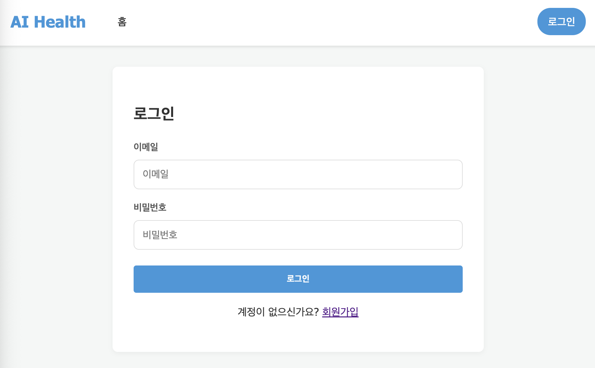
  - 실패: 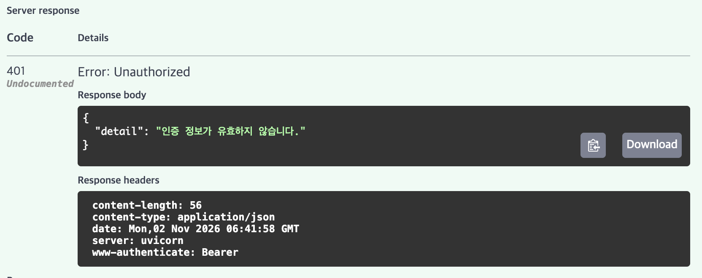
- 동작 설명:
  - 로그인 상태에서 로그아웃 버튼을 클릭하면 확인창 없이 로그인 화면으로 이동한다.
  - 서버 로그에서 POST /api/v1/auth/logout 요청의 200 OK 응답을 확인했다.
  - 로그아웃 후 발급받은 토큰의 재사용 차단 여부는 별도 검증하지 않았다.
  - 실패: 인증 토큰 없이 Swagger에서 로그아웃 API를 호출한 결과, 401 Unauthorized와 "인증 정보가 유효하지 않습니다." 메시지를 확인했다.

## 5. 회원 탈퇴 (REQ-USER-009)

- 담당: 김지수
- API: DELETE /api/v1/users/me
- 화면 경로: 
- 캡처
  - 성공:
  - 실패:
- 동작 설명:

## 6. 마이페이지 조회 (REQ-USER-006)

- 담당: 김지수
- API: GET /api/v1/users/me
- 화면 경로: 
- 캡처
  - 성공:
  - 실패:
- 동작 설명:

## 7. 회원 정보 수정 (REQ-USER-007)

- 담당: 이지희
- API: PATCH /api/v1/users/me
- 화면 경로: 마이페이지 → 정보 수정
- 캡처
  - 성공: 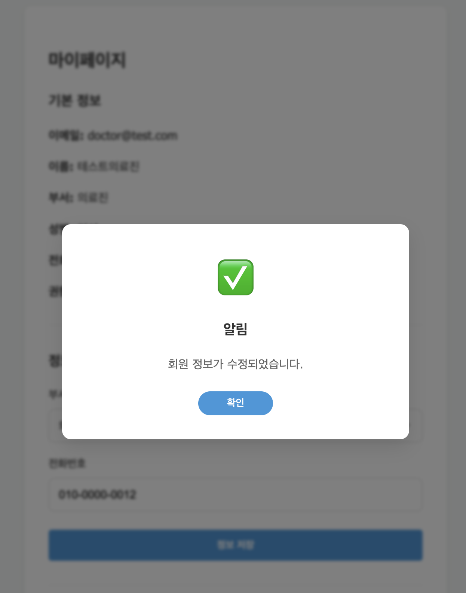
  - 변경 결과: 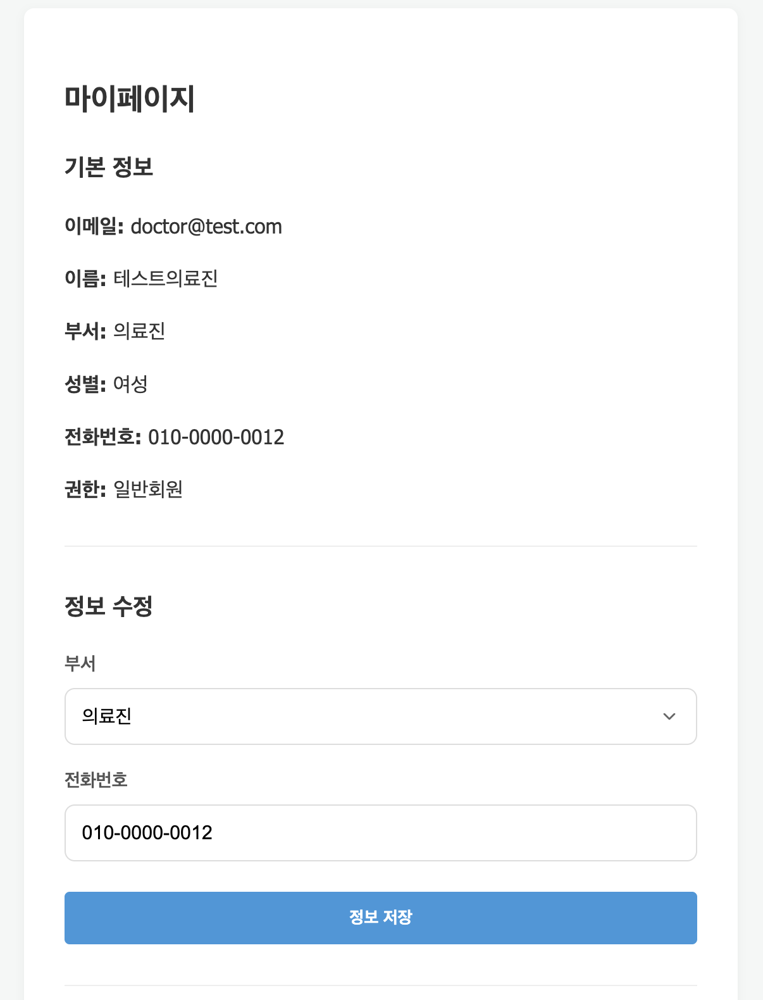
  - 실패: 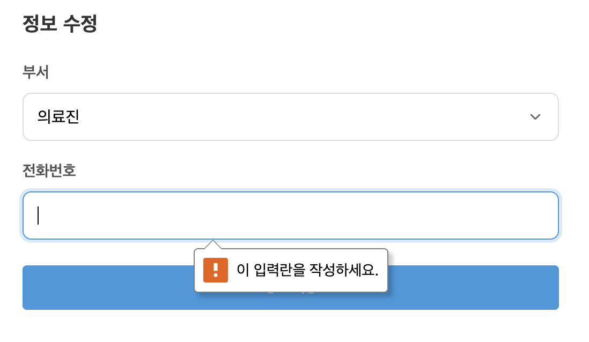
- 동작 설명:
  - 성공: 의료진 계정의 전화번호를 010-0000-0002에서 010-0000-0012로 변경했다. 성공 알림과 기본 정보에 변경된 값이 표시되는 것을 확인했다.
  - 실패: 전화번호를 공란으로 두고 정보 저장을 클릭하면 브라우저에서 "이 입력란을 작성하세요." 안내가 나타나 저장이 차단된다.
  - 실패 사례는 브라우저의 필수 입력 검증이며 API 오류 응답은 아니다.

## 8. 비밀번호 변경 (REQ-USER-008)

- 담당: 이지희
- API: PATCH /api/v1/users/me/password
- 화면 경로: 마이페이지 → 비밀번호 변경
- 캡처
  - 성공: 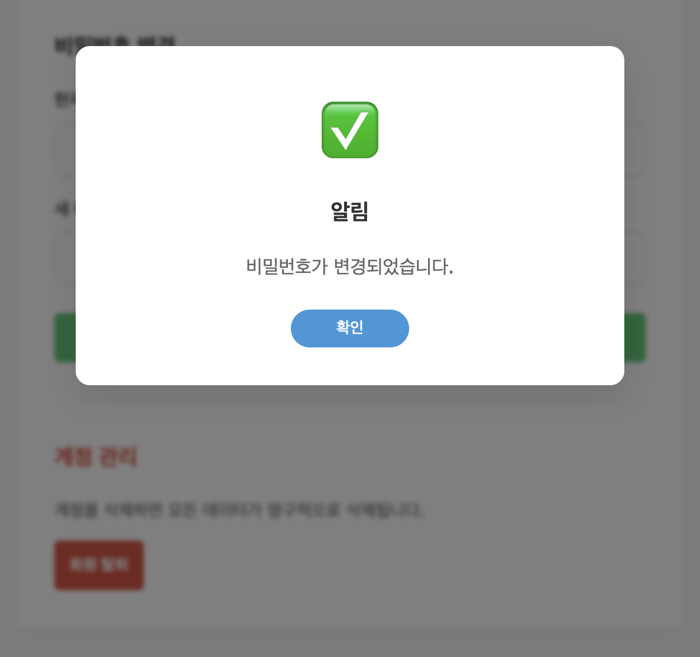
  - 실패: 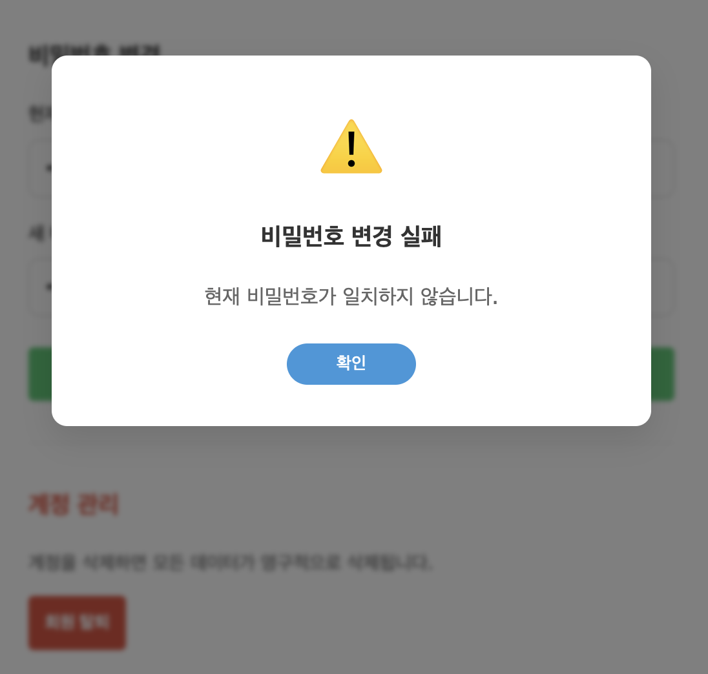
- 동작 설명:
  - 성공: 올바른 현재 비밀번호와 새로운 비밀번호를 입력하면 "비밀번호가 변경되었습니다." 알림이 표시된다. 서버 로그에서 200 OK 응답을 확인했다.
  - 실패: 현재 비밀번호를 잘못 입력하면 "현재 비밀번호가 일치하지 않습니다." 안내가 표시된다. 서버 로그에서 400 Bad Request 응답을 확인했다.

## 9. 회원 목록 조회 (REQ-USER-004)

- 담당: 김설아
- API: GET /api/v1/admin/users
- 화면 경로: 
- 캡처
  - 성공:
  - 실패:
- 동작 설명:

## 10. 회원 권한 변경 (REQ-USER-005)

- 담당: 김설아
- API: PATCH /api/v1/admin/users/{user_id}/role
- 화면 경로: 
- 캡처
  - 성공:
  - 실패:
- 동작 설명:

## 11. 환자 정보 등록 (REQ-PTNT-001)

- 담당: 홍시윤
- API: POST /api/v1/patients
- 화면 경로: 
- 캡처
  - 성공:
  - 실패:
- 동작 설명:

## 12. 환자 목록 조회 (REQ-PTNT-002)

- 담당: 홍시윤
- API: GET /api/v1/patients
- 화면 경로: 
- 캡처
  - 성공:
  - 실패:
- 동작 설명:

## 13. 환자 정보 상세 조회 (REQ-PTNT-003)

- 담당: 이지희
- API: GET /api/v1/patients/{patient_id}
- 화면 경로: 환자 관리 → 김오즈 상세보기
- 캡처
  - 성공: 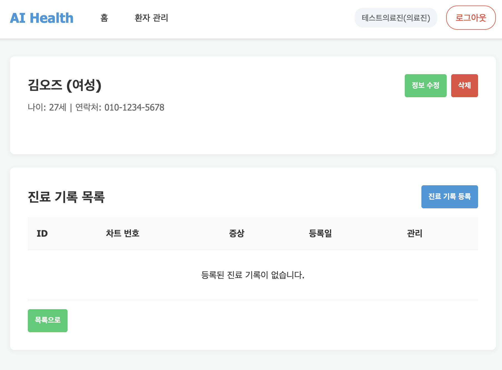
  - 실패: 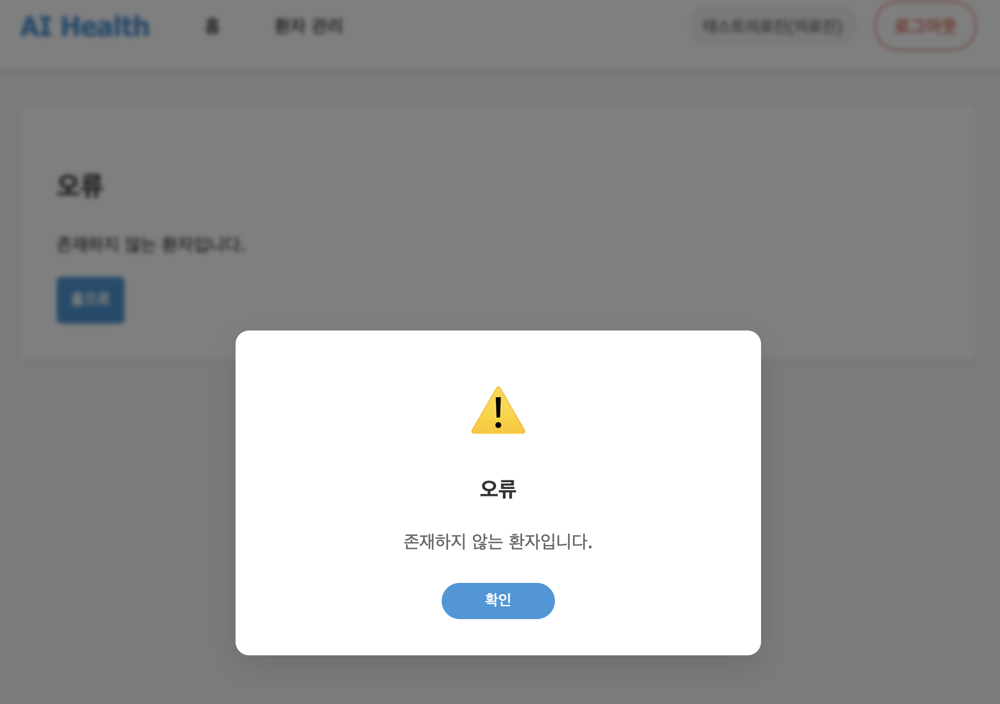
- 동작 설명:
  - 의료진 계정으로 등록된 환자 김오즈의 상세 화면에 접근했다.
  - 이름 김오즈, 나이 27세, 성별 여성, 연락처 010-1234-5678이 정상 표시되는 것을 확인했다.
  - 서버 로그에서 GET /api/v1/patients/1 요청의 200 OK 응답을 확인했다.
  - 진료기록이 등록되지 않아 "등록된 진료 기록이 없습니다."라는 안내가 표시됐다.
  - 실패: 존재하지 않는 환자 ID(99999)로 상세 화면에 접근했을 때 "존재하지 않는 환자입니다."라는 오류 안내가 표시되는 것을 확인했다.

## 14. 환자 정보 수정 (REQ-PTNT-004)

- 담당: 이지희
- API: PATCH /api/v1/patients/{patient_id}
- 화면 경로: 환자 관리 → 환자 상세보기 → 정보 수정
- 캡처
  - 성공: 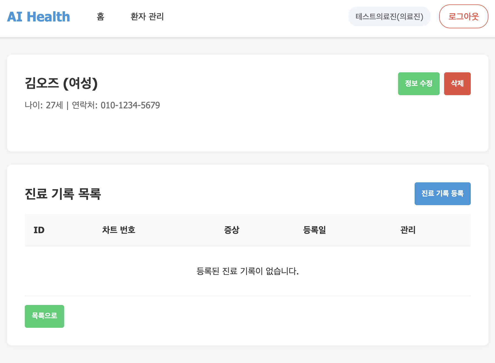
  - 성공 알림: 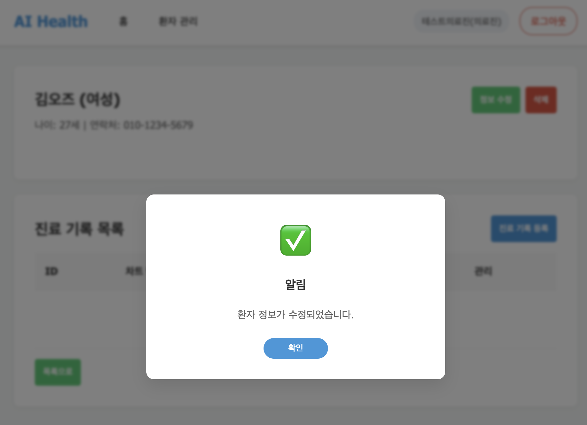
  - 실패: 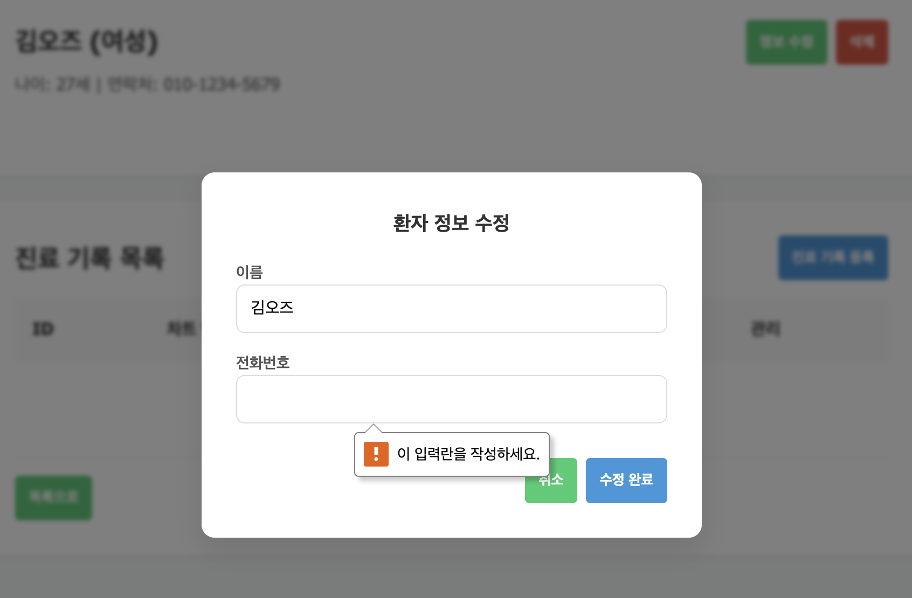
- 동작 설명:  
  - 성공: 김오즈의 전화번호를 010-1234-5678에서 010-1234-5679로 변경했다. 성공 알림이 표시되고 상세 화면에도 수정된 전화번호가 유지되는 것을 확인했다.
  - 실패: 전화번호를 공란으로 두고 수정 완료를 클릭하면 "이 입력란을 작성하세요." 안내가 나타나 저장이 차단된다.
  - 영문자 및 최대 길이를 초과한 숫자의 입력이 제한되는 것도 확인했다.
  - 실패 사례는 브라우저 입력 검증이며 API 오류 응답은 아니다.

## 15. 환자 정보 삭제 (REQ-PTNT-005)

- 담당: 김지수
- API: DELETE /api/v1/patients/{patient_id}
- 화면 경로: 
- 캡처
  - 성공:
  - 실패:
- 동작 설명:

## 16. 진료기록 등록 (REQ-MDR-001)

- 담당: 김지수
- API: POST /api/v1/patients/{patient_id}/medical-records
- 화면 경로: 
- 캡처
  - 성공:
  - 실패:
- 동작 설명:

## 17. 진료기록 목록 조회 (REQ-MDR-002)

- 담당: 김설아
- API: GET /api/v1/patients/{patient_id}/medical-records
- 화면 경로: 
- 캡처
  - 성공:
  - 실패:
- 동작 설명:

## 18. 진료기록 상세 조회 (REQ-MDR-003)

- 담당: 김설아
- API: GET /api/v1/medical-records/{record_id}
- 화면 경로: 
- 캡처
  - 성공:
  - 실패:
- 동작 설명:

## 19. AI 폐렴 예측 (REQ-PRED-001)

- 담당: 홍시윤
- API: POST /api/v1/medical-records/{record_id}/predictions
- 화면 경로: 
- 캡처
  - 성공:
  - 실패:
- 동작 설명:

## 20. 예측 결과 목록 조회 (REQ-PRED-002)

- 담당: 김지수
- API: GET /api/v1/medical-records/{record_id}/predictions
- 화면 경로: 
- 캡처
  - 성공:
  - 실패:
- 동작 설명:

