# 7일차_앱 실행화면

## 공통 안내

- 실행 방법: `fastapi run app/main.py`
- 테스트 계정: 홍시윤 님 가이드 참고
- 캡처 저장 위치: `docs/images/`
- 캡처 파일명: `Day7_API이름.png`

## 1. 회원가입 (REQ-USER-001)

- 담당: 홍시윤
- API: POST /api/v1/auth/signup
- 화면 경로: /signup
- 캡처
  - 성공: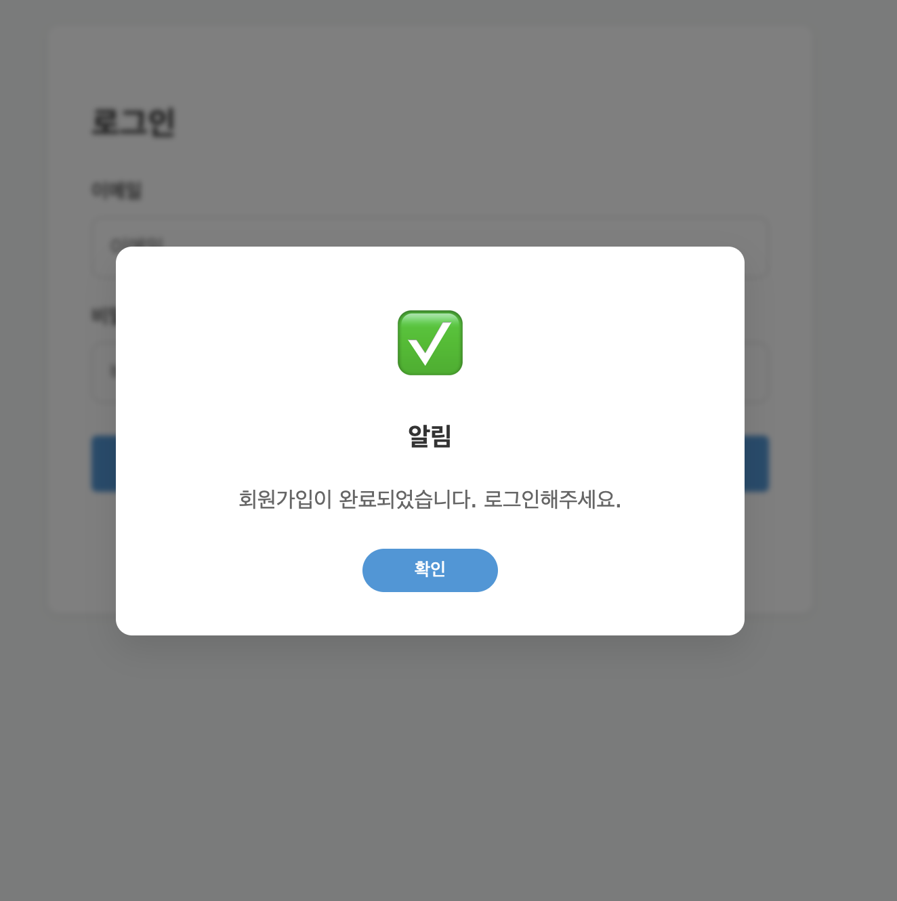
  - 실패: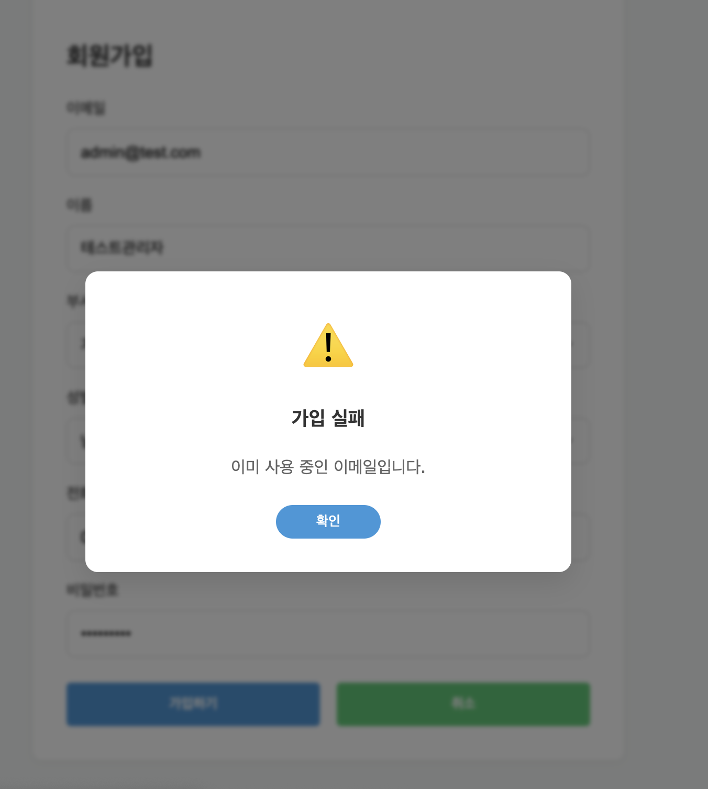
- 동작 설명: 이메일, 비밀번호, 이름, 부서, 성별, 휴대폰 번호를 입력해 가입하면 계정이 생성되고(권한은 승인 대기) 로그인 화면으로 이동한다. 이미 가입된 이메일로 가입하면 409 오류와 안내 문구가 표시된다.

## 2. 로그인 (REQ-USER-002)

- 담당: 홍시윤
- API: POST /api/v1/auth/login
- 화면 경로: /login
- 캡처
  - 성공: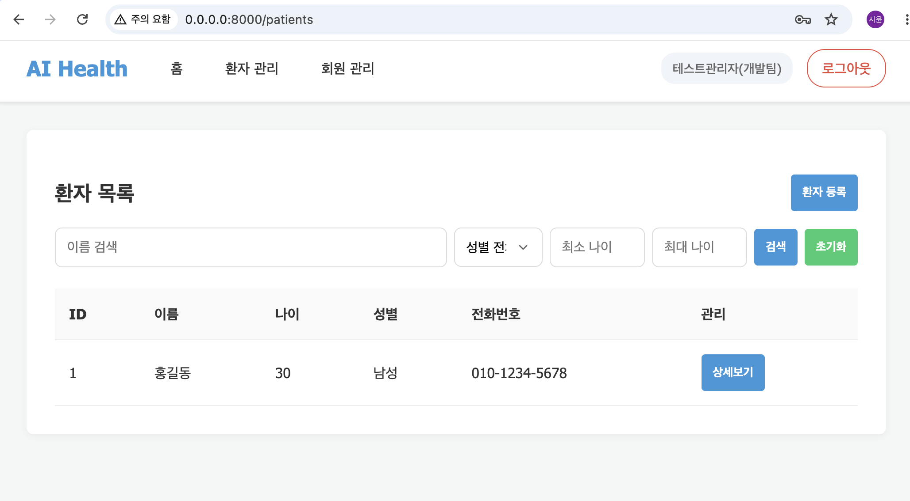
  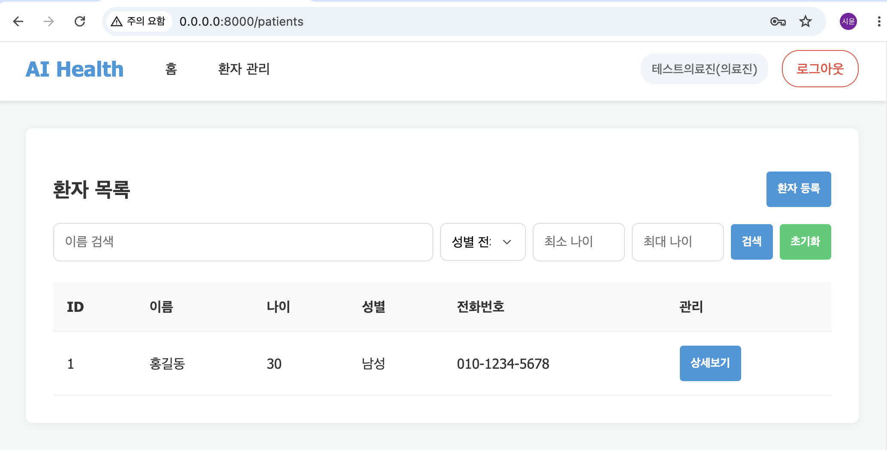
  - 실패: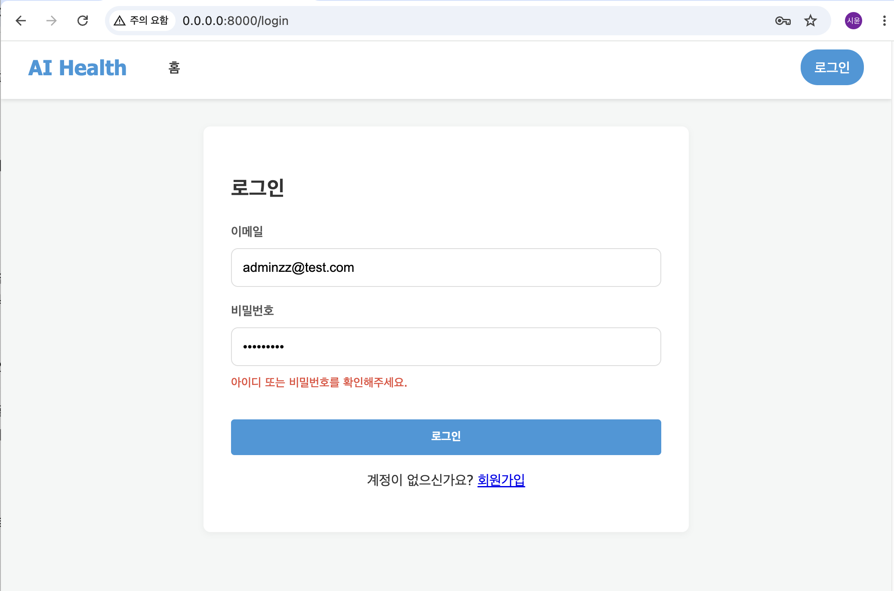
  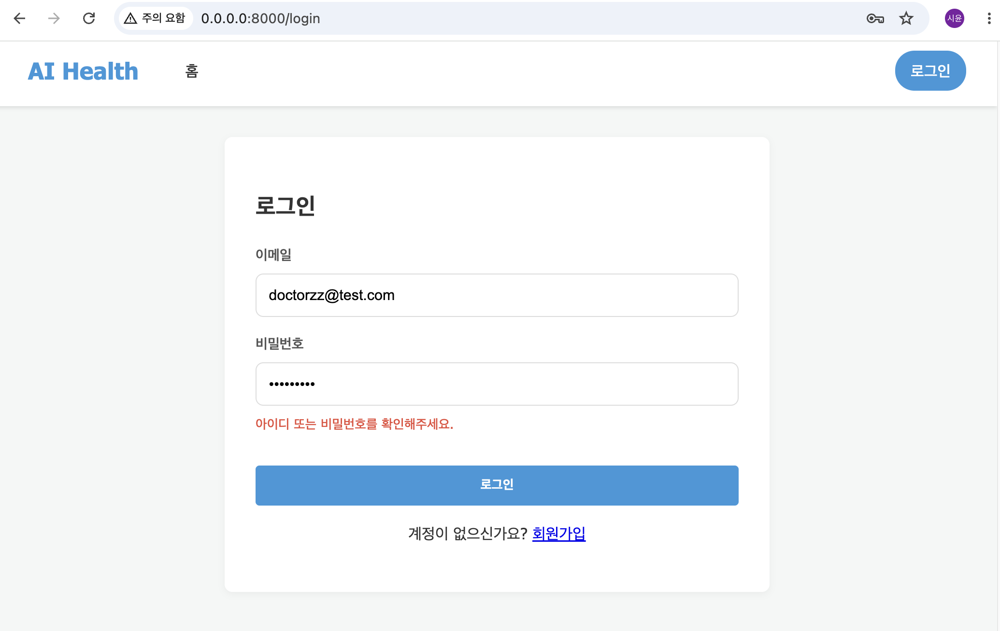
- 동작 설명: 이메일과 비밀번호가 맞으면 액세스 토큰을 받고 리프레시 토큰은 쿠키에 저장되어 서비스 화면으로 이동한다. 틀리면 401 오류 문구가 표시된다.

## 3. 토큰 재발급 (NFR-USER-001)

- 담당: 홍시윤
- API: POST /api/v1/auth/refresh
- 화면 경로: 개발자 도구
- 캡처
  - 성공: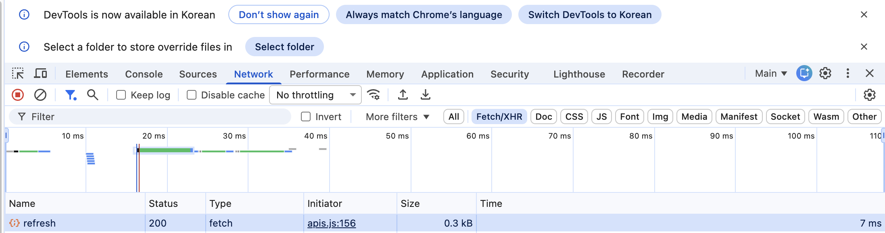
  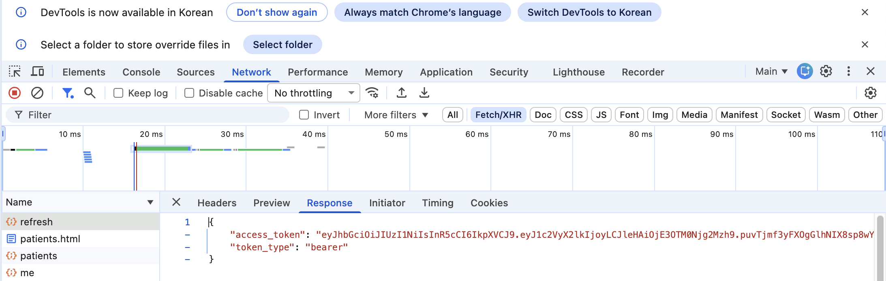
  - 실패: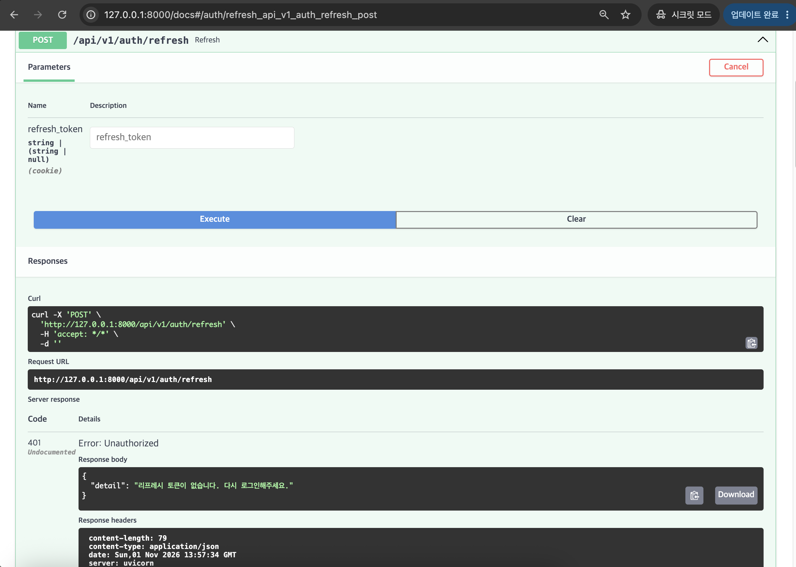
- 동작 설명:액세스 토큰(30분)이 만료되면 쿠키의 리프레시 토큰으로 새 액세스 토큰을 발급받는다. 리프레시 토큰이 없거나 만료되면 401이 나고 로그인 화면으로 이동한다. (토큰 재발급 실패는 /docs API 문서에서 캡처 진행함)

## 4. 로그아웃 (REQ-USER-003)

- 담당: 이지희
- API: POST /api/v1/auth/logout
- 화면 경로: 
- 캡처
  - 성공:
  - 실패:
- 동작 설명:

## 5. 회원 탈퇴 (REQ-USER-009)

- 담당: 김지수
- API: DELETE /api/v1/users/me
- 화면 경로: /my-page
- 캡처
  - 성공: 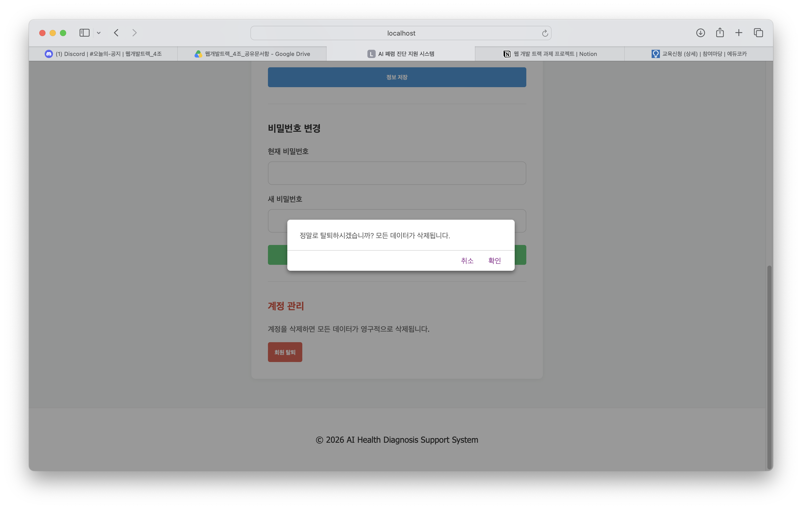
  - 실패: 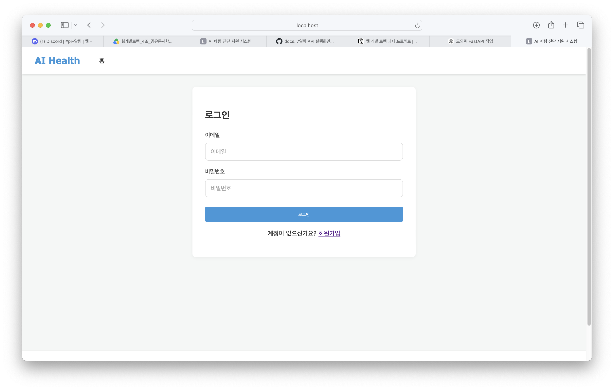
- 동작 설명:회원 탈퇴 버튼을 클릭하고 확인하면 계정이 삭제되며 로그인 화면으로 이동합니다.로그아웃 상태에서 마이페이지에 접근하면 로그인 화면으로 이동하여 회원 탈퇴 기능을 이용할 수 없음을 확인하였습니다.

## 6. 마이페이지 조회 (REQ-USER-006)

- 담당: 김지수
- API: GET /api/v1/users/me
- 화면 경로: /my-page
- 캡처
  - 성공: 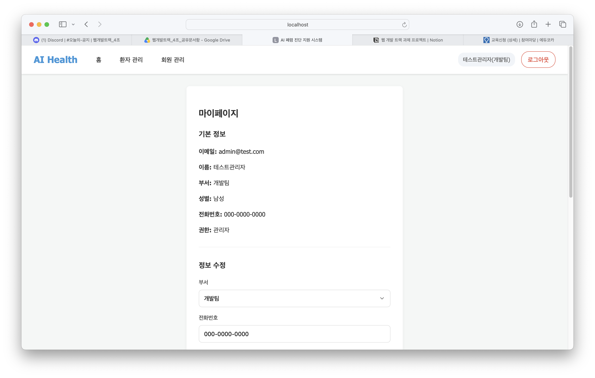
  - 실패: 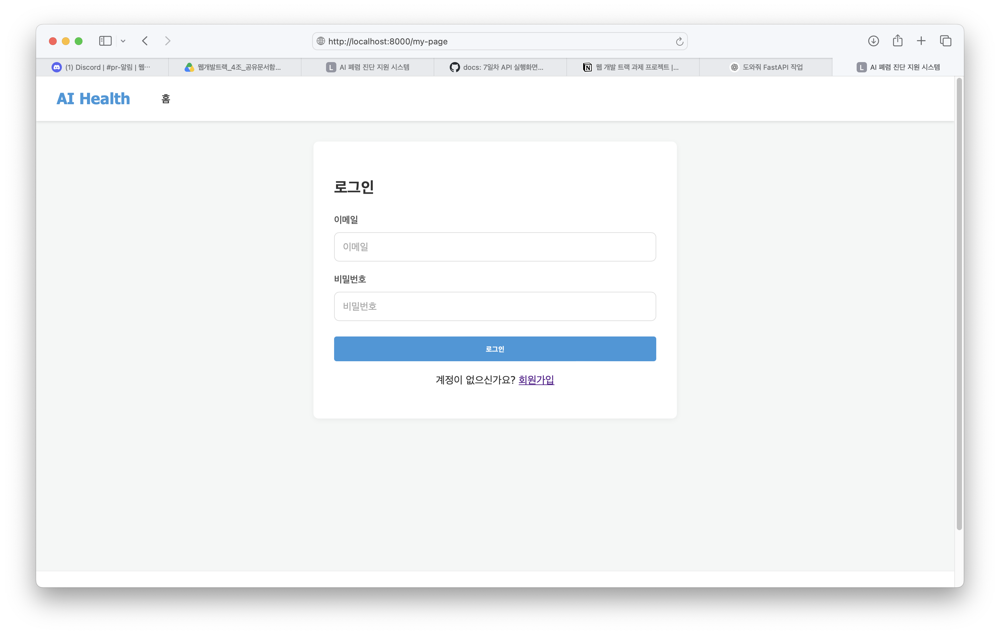
- 동작 설명:로그인한 사용자의 마이페이지에 이메일, 이름, 부서, 성별, 전화번호, 권한 등 기본 정보가 정상적으로 표시되는 것을 확인하였습니다.로그아웃한 상태에서 마이페이지에 접근하면 로그인 화면으로 이동하며, 인증되지 않은 사용자는 마이페이지 정보를 조회할 수 없음을 확인하였습니다.

## 7. 회원 정보 수정 (REQ-USER-007)

- 담당: 이지희
- API: PATCH /api/v1/users/me
- 화면 경로: 
- 캡처
  - 성공:
  - 실패:
- 동작 설명:

## 8. 비밀번호 변경 (REQ-USER-008)

- 담당: 이지희
- API: PATCH /api/v1/users/me/password
- 화면 경로: 
- 캡처
  - 성공:
  - 실패:
- 동작 설명:

## 9. 회원 목록 조회 (REQ-USER-004)

- 담당: 김설아
- API: GET /api/v1/admin/users
- 화면 경로: /admin/users (상단 메뉴 `회원 관리`, 관리자에게만 보임)
- 캡처
  - 성공: 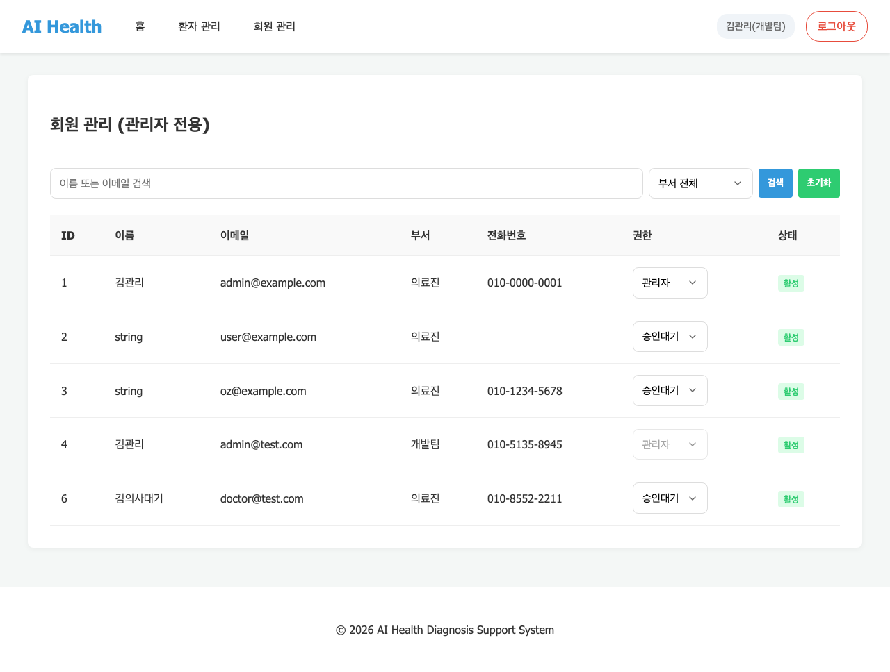
  - 실패: 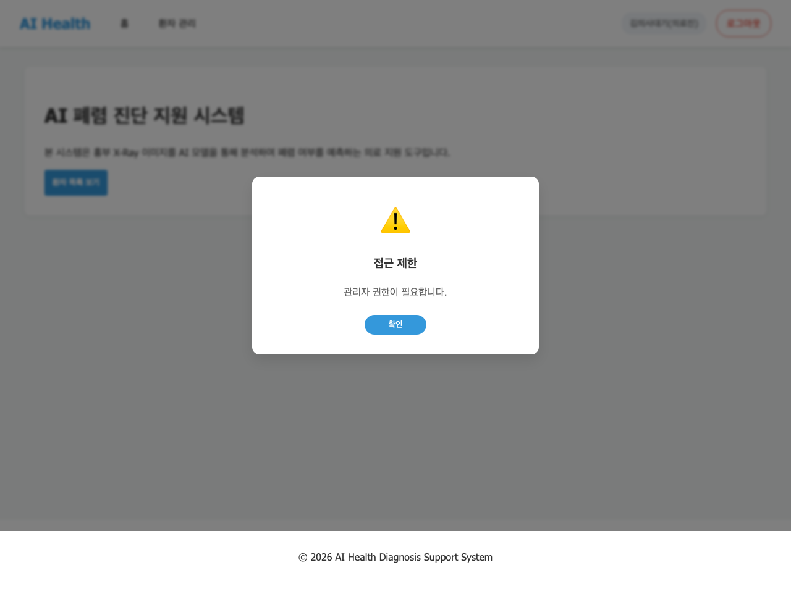
- 동작 설명:
  - `admin@test.com`으로 로그인하면 상단에 `회원 관리` 메뉴가 생기고, 누르면 `GET /api/v1/admin/users`를 호출해 전체 회원을 ID 순으로 표에 보여줍니다. (ID, 이름, 이메일, 부서, 전화번호, 권한, 상태)
  - 검색창에 이름 또는 이메일 일부를 입력하고 `검색`(또는 Enter)을 누르면 `?search=`가, 부서 선택 상자를 바꾸면 `?department=`가 붙어서 다시 조회합니다. 주소창에도 조건이 남아 새로고침해도 검색 조건이 유지되고, `초기화`를 누르면 전체 목록으로 돌아갑니다.
  - 조건에 맞는 회원이 없으면 표에 `검색 결과가 없습니다.`가 나옵니다.
  - 실패: 관리자가 아닌 계정(`doctor@test.com`)으로 `/admin/users`에 들어가면 `관리자 권한이 필요합니다.` 알림창이 뜨고 홈으로 이동합니다. 화면을 거치지 않고 API를 직접 호출해도 서버가 `403` `{"detail": "관리자 권한이 필요합니다."}`로 막습니다.

## 10. 회원 권한 변경 (REQ-USER-005)

- 담당: 김설아
- API: PATCH /api/v1/admin/users/{user_id}/role
- 화면 경로: /admin/users (회원 목록 표의 `권한` 열)
- 캡처
  - 성공: 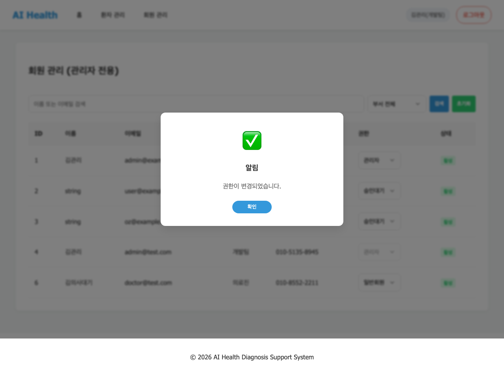
  - 실패: 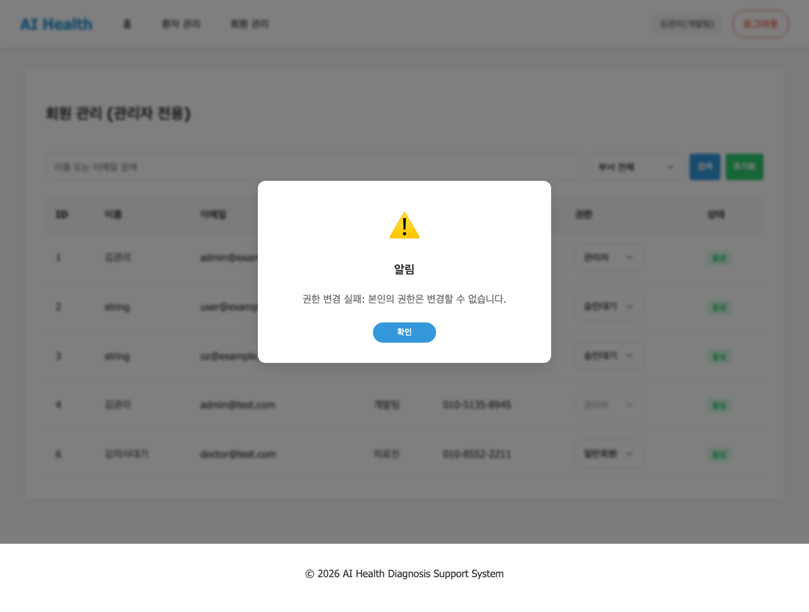
- 동작 설명:
  - 회원 목록 표의 `권한` 선택 상자에서 `승인대기` / `일반회원` / `관리자` 중 하나를 고르면 바로 `PATCH /api/v1/admin/users/{user_id}/role`에 `{"role": "staff"}` 같은 값을 보냅니다. (따로 저장 버튼 없음)
  - 성공하면 `권한이 변경되었습니다.` 알림창이 뜨고, 지금 걸려 있는 검색 조건 그대로 목록을 다시 불러와 바뀐 권한을 보여줍니다.
  - 권한은 토큰이 아니라 DB에서 매번 확인하므로, 예를 들어 `pending@test.com`을 `일반회원`으로 바꾸면 그 사용자가 다시 로그인하지 않아도 바로 환자 화면에 들어갈 수 있습니다.
  - 실패: 로그인한 관리자 본인 행의 선택 상자는 비활성화되어 있어 화면에서는 본인 권한을 바꿀 수 없습니다. API를 직접 호출하면 서버가 `400` `{"detail": "본인의 권한은 변경할 수 없습니다."}`로 막고, 없는 회원 id면 `404` `{"detail": "존재하지 않는 회원입니다."}`가 나옵니다. 화면에서 요청이 실패하면 `권한 변경 실패: (서버 메시지)` 알림창이 뜹니다.

## 11. 환자 정보 등록 (REQ-PTNT-001)

- 담당: 홍시윤
- API: POST /api/v1/patients
- 화면 경로: 로그인 → 환자 관리 메뉴 → 환자 정보 등록 버튼 → 모달
- 캡처
  - 성공: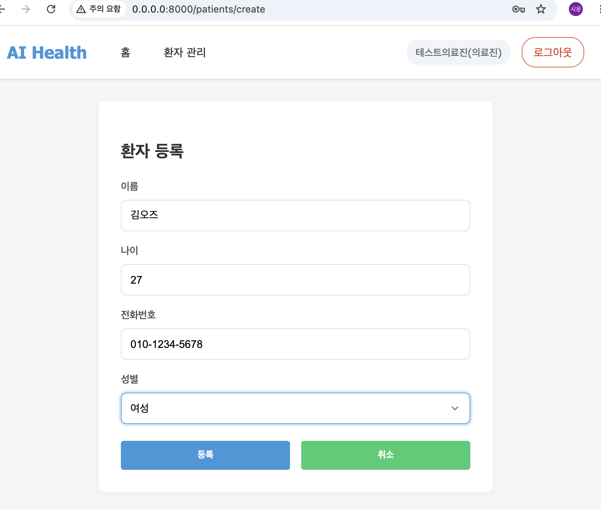
  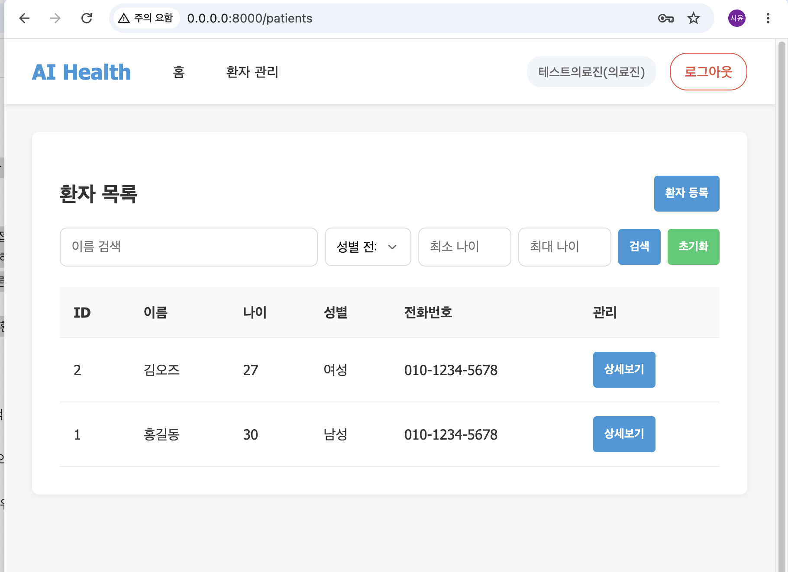
  - 실패: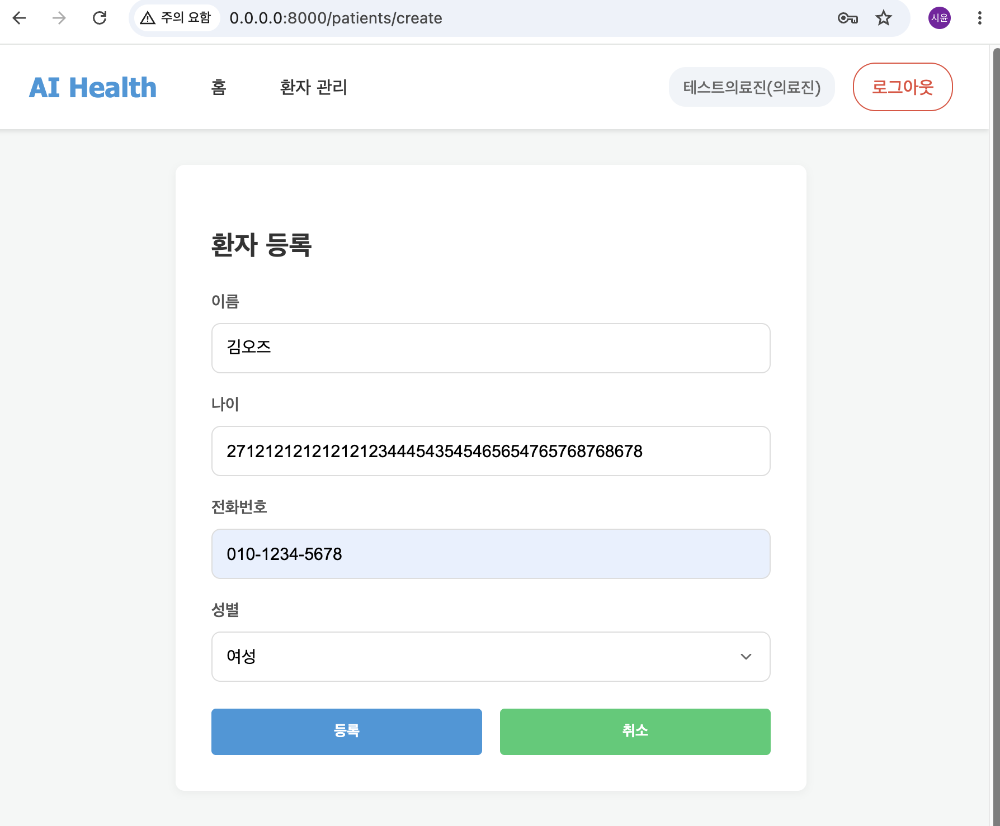
  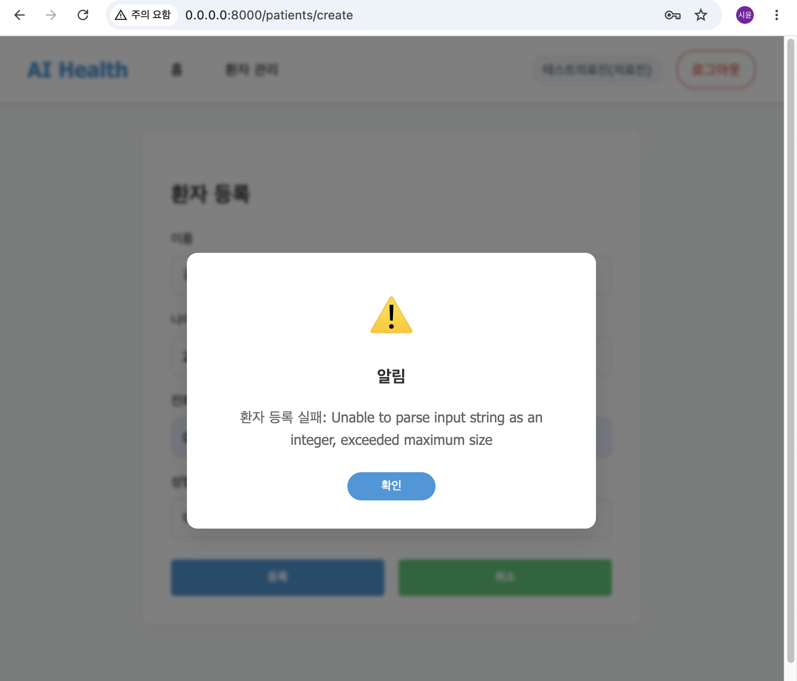
- 동작 설명: 의료진(staff 중 의료 부서) 또는 admin이 이름, 나이, 성별, 연락처를 입력해 환자를 등록하면 201로 저장되고 목록에 표시된다. 권한이 없으면 403이 표시된다.

## 12. 환자 목록 조회 (REQ-PTNT-002)

- 담당: 홍시윤
- API: GET /api/v1/patients
- 화면 경로: 로그인 → 환자 관리 메뉴 → 환자 목록 조회 → 검색
- 캡처
  - 성공: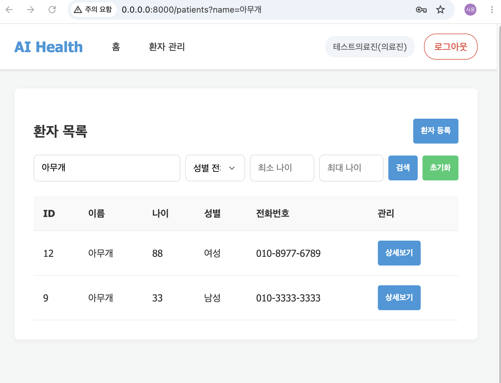
  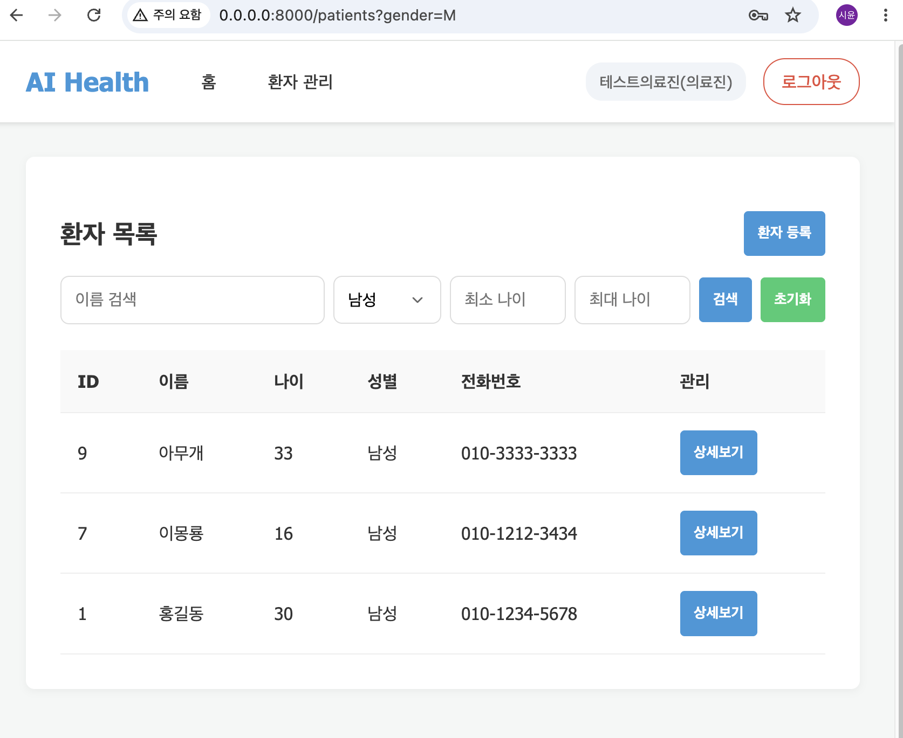
  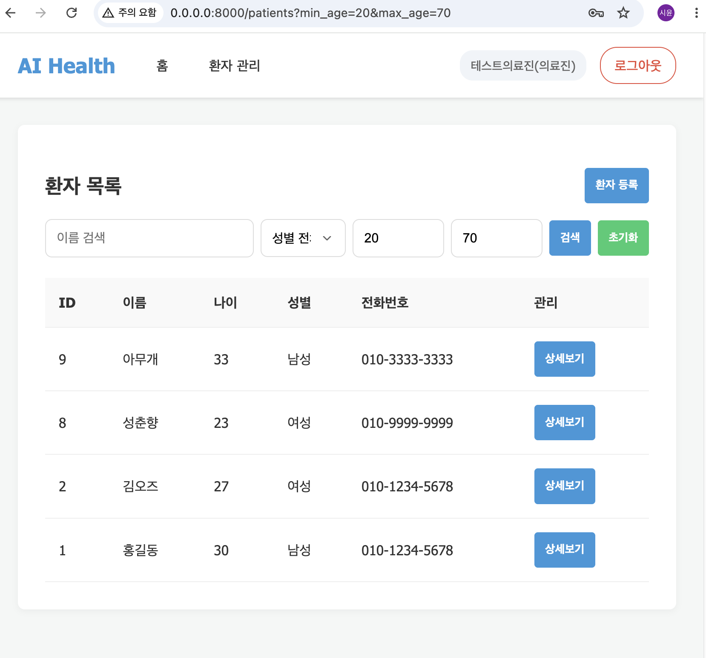
  - 실패: 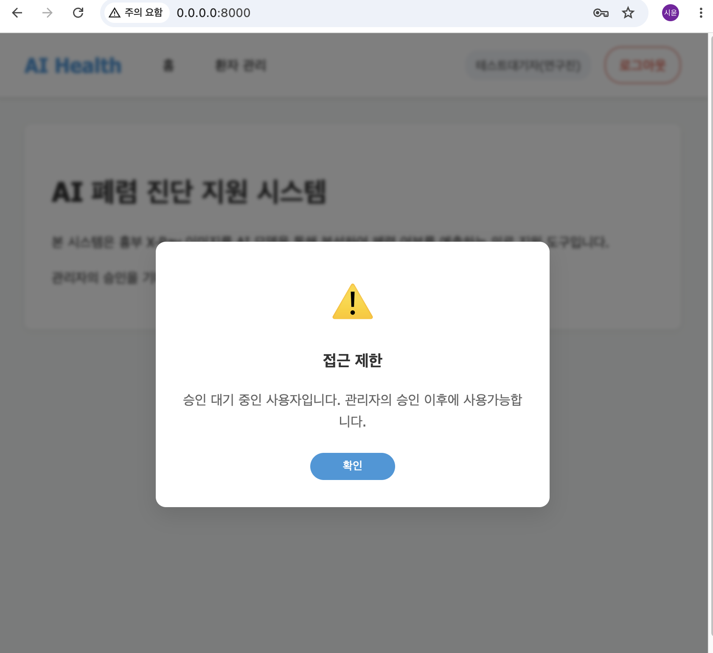
- 동작 설명:staff 이상 계정은 등록된 환자를 목록으로 조회하고 이름 검색과 성별, 나이 범위 필터를 쓸 수 있다. 결과가 없으면 빈 목록 안내가 표시되고, 대기자는 403이 표시된다.

## 13. 환자 정보 상세 조회 (REQ-PTNT-003)

- 담당: 이지희
- API: GET /api/v1/patients/{patient_id}
- 화면 경로: 
- 캡처
  - 성공:
  - 실패:
- 동작 설명:

## 14. 환자 정보 수정 (REQ-PTNT-004)

- 담당: 이지희
- API: PATCH /api/v1/patients/{patient_id}
- 화면 경로: 
- 캡처
  - 성공:
  - 실패:
- 동작 설명:

## 15. 환자 정보 삭제 (REQ-PTNT-005)

- 담당: 김지수
- API: DELETE /api/v1/patients/{patient_id}
- 화면 경로: /patients/2
- 캡처
  - 성공: 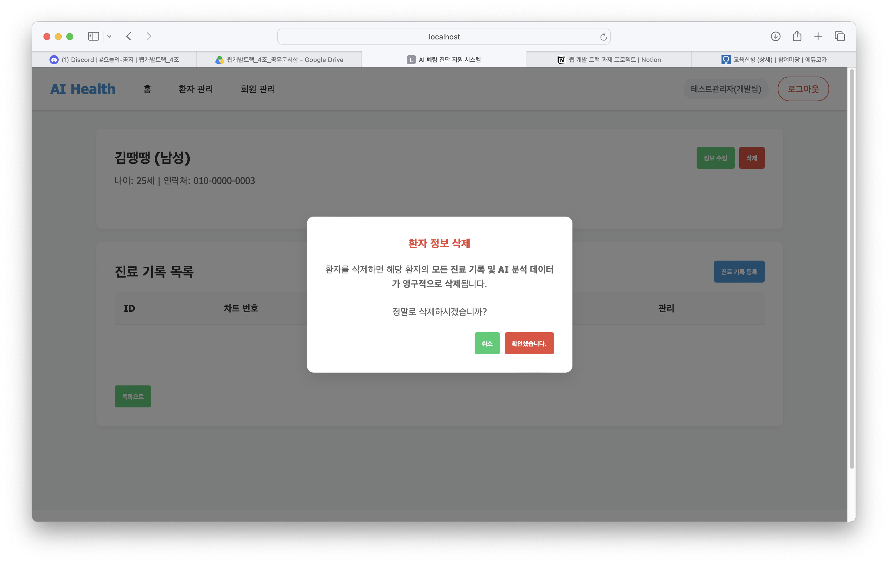
  - 실패: 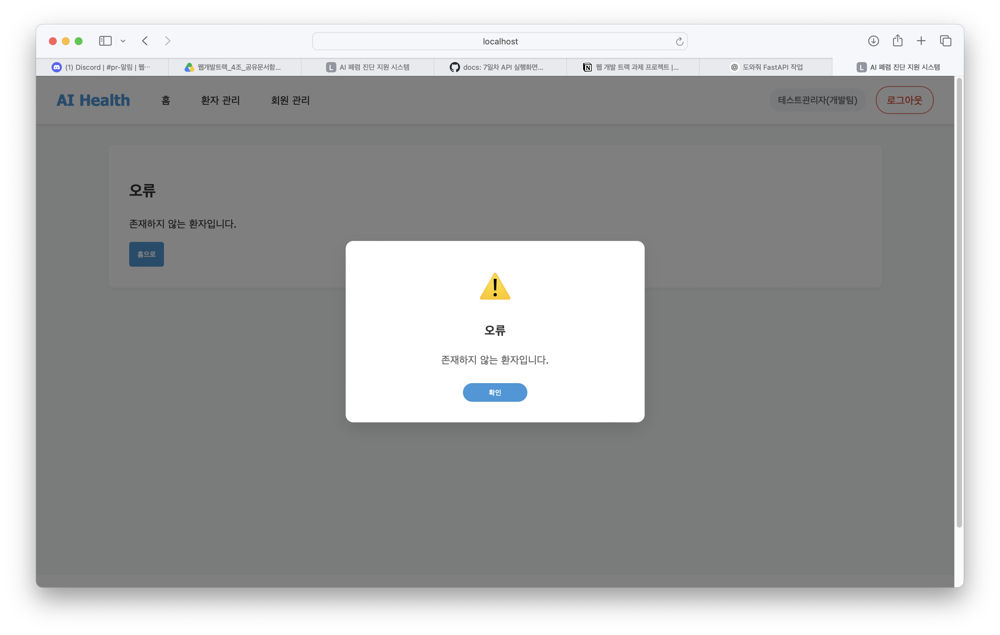
- 동작 설명:환자 상세 화면에서 삭제 버튼을 클릭하면 삭제 확인창이 나타납니다. 삭제 시 해당 환자의 진료기록과 AI 분석 데이터도 함께 삭제된다는 안내가 표시됩니다. 사용자가 삭제를 확인하면 환자 정보가 삭제됩니다.환자 상세 화면에서 삭제 버튼을 클릭하면 삭제 확인창이 나타납니다. 삭제를 확인하면 환자 정보가 삭제됩니다. 또한 존재하지 않는 환자 ID(9999)로 접근하면 "존재하지 않는 환자입니다."라는 오류 메시지가 표시되는 것을 확인하였습니다.

## 16. 진료기록 등록 (REQ-MDR-001)

- 담당: 김지수
- API: POST /api/v1/patients/{patient_id}/medical-records
- 화면 경로: /patients/1/medical-records/create
- 캡처
  - 성공: 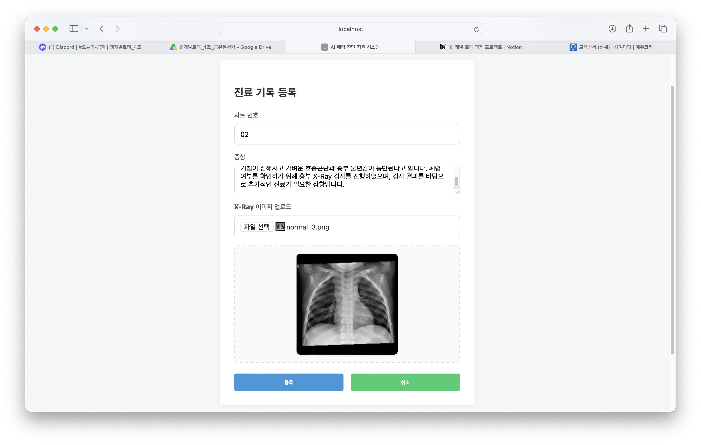
  - 실패: 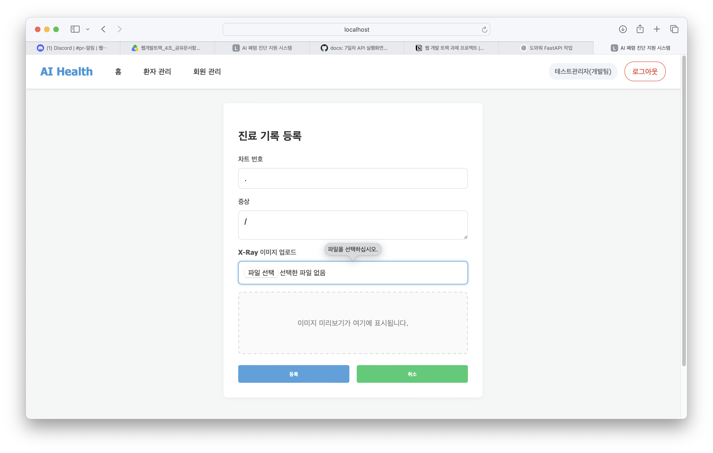
- 동작 설명:환자 상세 화면에서 진료 기록 등록 버튼을 클릭한 후 차트 번호, 증상, X-Ray 이미지를 입력하여 진료기록을 등록하였습니다. 등록 완료 후 환자의 진료기록 목록에 새로운 기록이 정상적으로 추가되는 것을 확인하였습니다. X-Ray 이미지를 첨부하지 않고 등록을 시도하면 "파일을 선택하십시오."라는 안내가 표시되며 등록이 진행되지 않는 것을 확인하였습니다.

## 17. 진료기록 목록 조회 (REQ-MDR-002)

- 담당: 김설아
- API: GET /api/v1/patients/{patient_id}/medical-records
- 화면 경로: /patients/{patient_id} (환자 상세 화면 아래쪽 진료기록 표)
- 캡처
  - 성공: 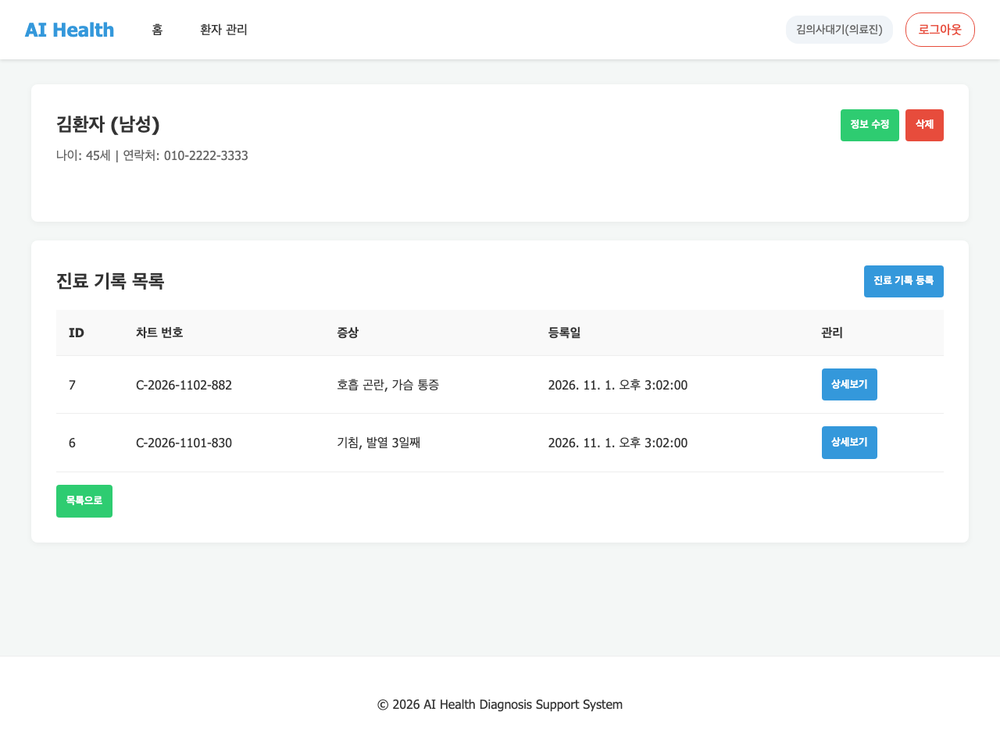
  - 실패: 
- 동작 설명:
  - 환자 목록에서 `상세보기`를 누르면 환자 상세 화면으로 이동하면서 환자 정보와 함께 `GET /api/v1/patients/{patient_id}/medical-records`를 호출합니다.
  - 해당 환자의 진료기록을 최신 등록순으로 표에 보여줍니다. (ID, 차트 번호, 증상, 등록일시, `상세보기` 버튼)
  - 등록된 진료기록이 없으면 표에 `등록된 진료 기록이 없습니다.`가 나오고, `진료 기록 등록` 버튼으로 진료기록 등록 화면에 갈 수 있습니다.
  - 실패: 존재하지 않는 환자 번호로 주소를 직접 입력하면(예: `/patients/99999`) `존재하지 않는 환자입니다.` 오류 알림창과 오류 화면이 나옵니다. (API 응답 `404`) 승인대기(`pending`) 계정은 화면에서 `승인 대기 중인 사용자입니다.` 알림 후 홈으로 이동하고, API를 직접 호출하면 `403` `{"detail": "접근 권한이 없습니다."}`가 나옵니다.

## 18. 진료기록 상세 조회 (REQ-MDR-003)

- 담당: 김설아
- API: GET /api/v1/medical-records/{record_id}
- 화면 경로: /medical-records/{record_id}
- 캡처
  - 성공: 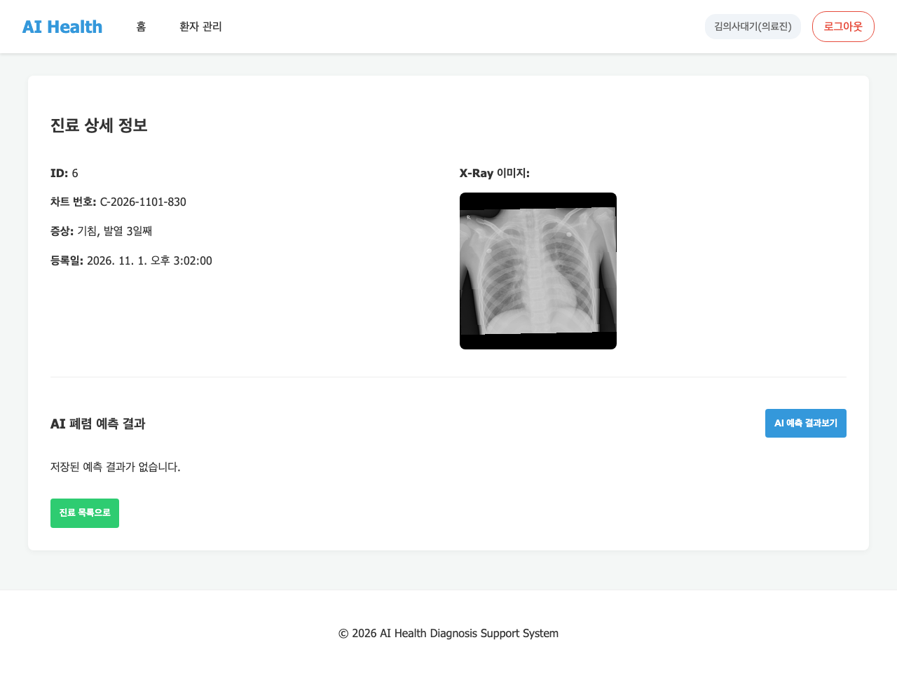
  - 실패: 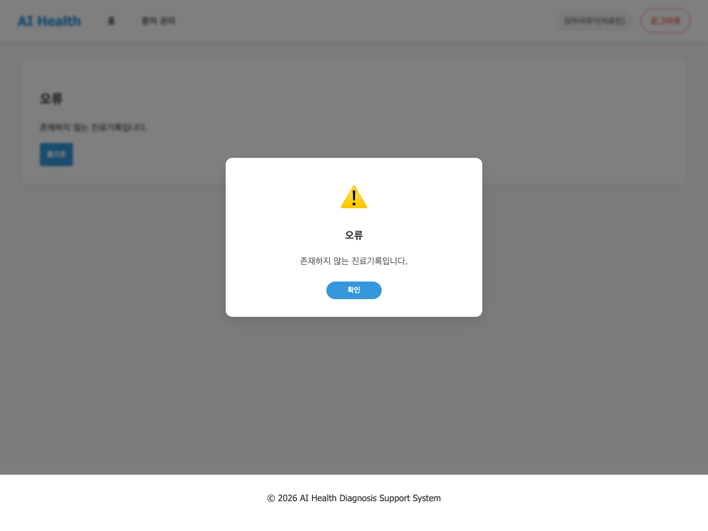
- 동작 설명:
  - 환자 상세 화면의 진료기록 표에서 `상세보기`를 누르면 `GET /api/v1/medical-records/{record_id}`를 호출해 기록 ID, 차트 번호, 증상, 등록일시를 보여줍니다.
  - X-Ray 이미지는 비공개 폴더에 있어서 `GET /api/v1/medical-records/{record_id}/xray-image`로 로그인 확인 후 받아와 화면에 표시합니다. 이미지를 못 받으면 `X-Ray 이미지를 불러올 수 없습니다.` 문구로 바뀝니다.
  - 같은 화면에 저장된 AI 예측 결과 목록과 `AI 예측 결과보기` 버튼이 함께 나오고, `진료 목록으로` 버튼을 누르면 해당 환자 상세 화면으로 돌아갑니다.
  - 실패: 존재하지 않는 기록 번호로 주소를 직접 입력하면(예: `/medical-records/99999`) `존재하지 않는 진료기록입니다.` 오류 알림창과 오류 화면이 나옵니다. (API 응답 `404`)

## 19. AI 폐렴 예측 (REQ-PRED-001)

- 담당: 홍시윤
- API: POST /api/v1/medical-records/{record_id}/predictions
- 화면 경로: doctor로 환자 상세 → 진료기록 등록 → 진료기록 상세 → AI 예측 결과보기 버튼
- 캡처
  - 성공: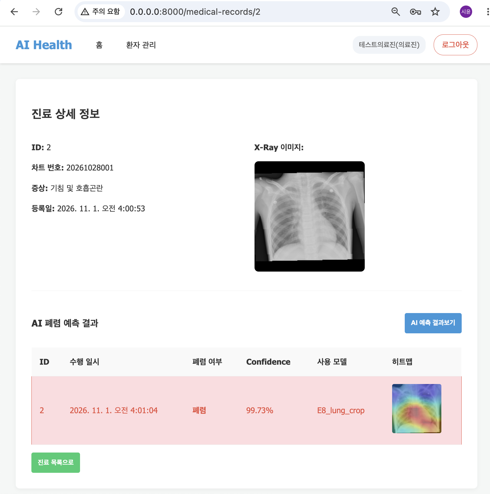
  - 실패: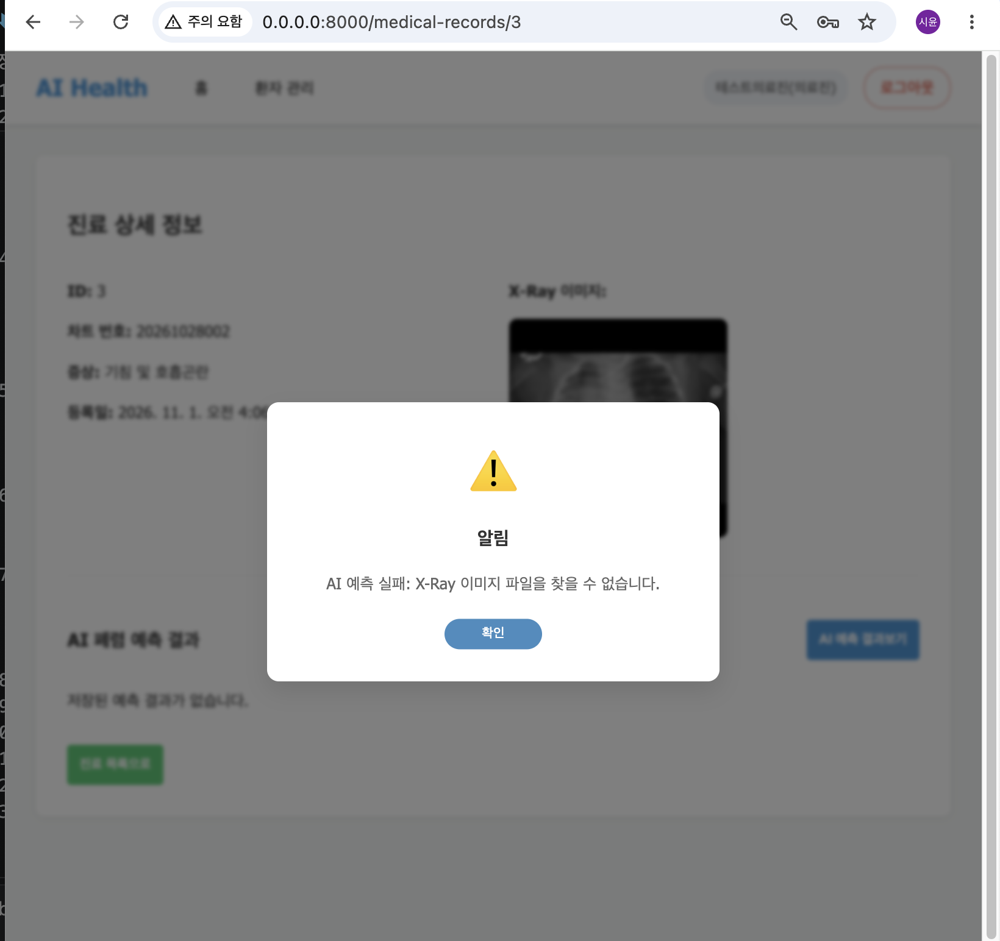
- 동작 설명: 진료기록에 등록된 X-Ray로 AI 모델이 폐렴 여부와 신뢰도, 히트맵을 예측해 처음 요청하면 201로 저장하고, 같은 모델의 저장된 결과가 있으면 200으로 그대로 보여준다. 이미지 파일이 없으면 404가 표시된다.

## 20. 예측 결과 목록 조회 (REQ-PRED-002)

- 담당: 김지수
- API: GET /api/v1/medical-records/{record_id}/predictions
- 화면 경로: /medical-records/2
- 캡처
  - 성공: 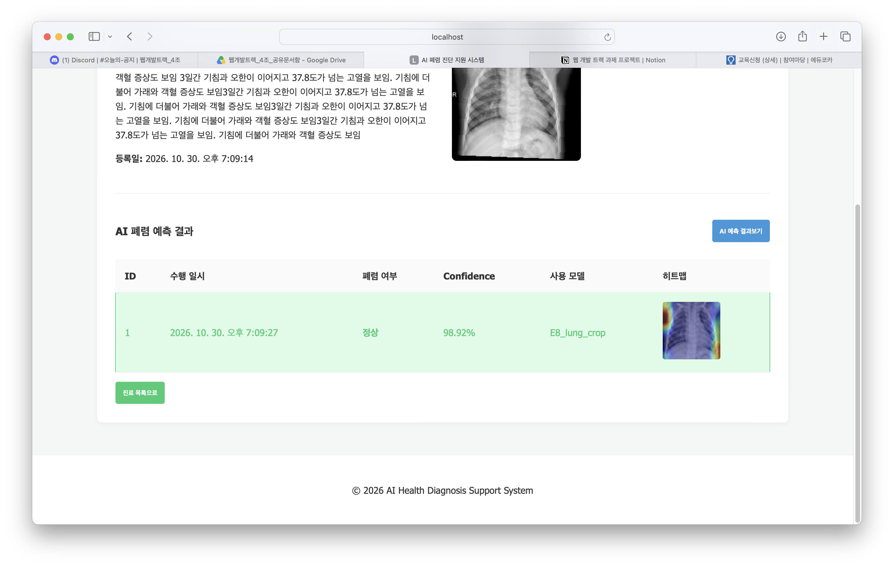
  - 실패: 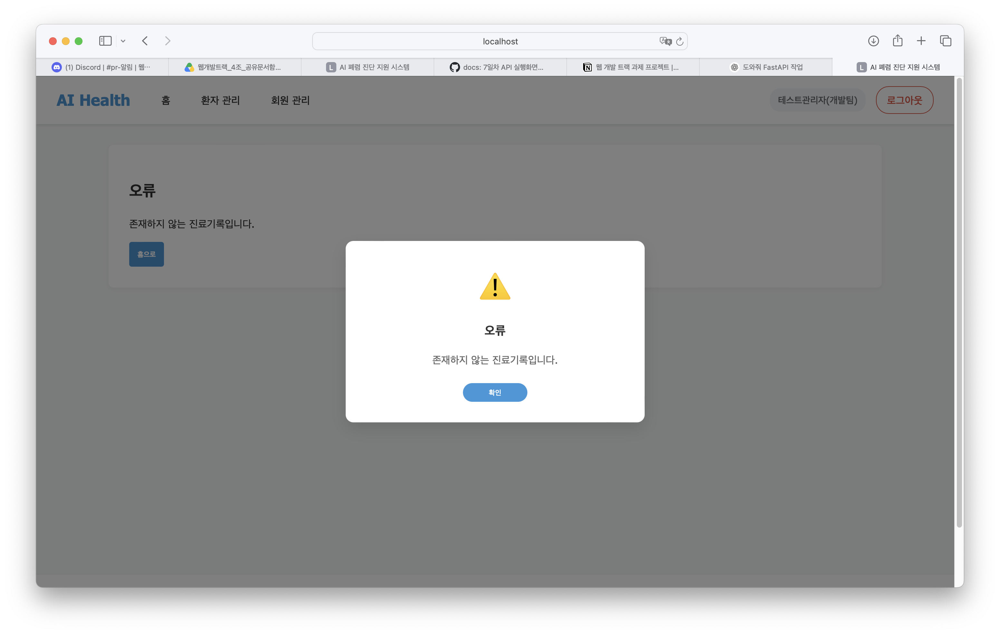
- 동작 설명:진료기록 상세 화면에서 AI 폐렴 예측 결과 목록을 조회하였습니다. 예측 결과의 폐렴 여부, 신뢰도, 사용된 AI 모델명 및 히트맵 이미지가 정상적으로 표시되는 것을 확인하였습니다.

