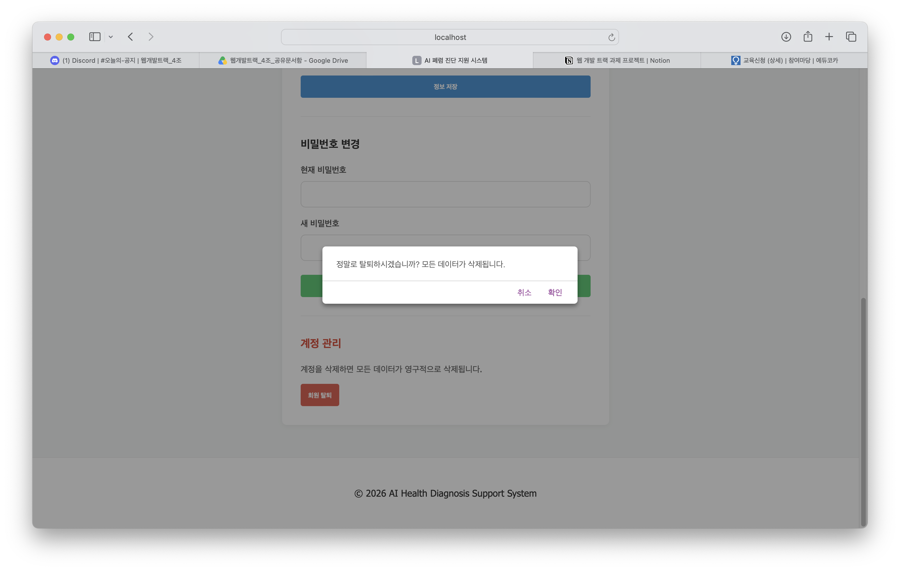
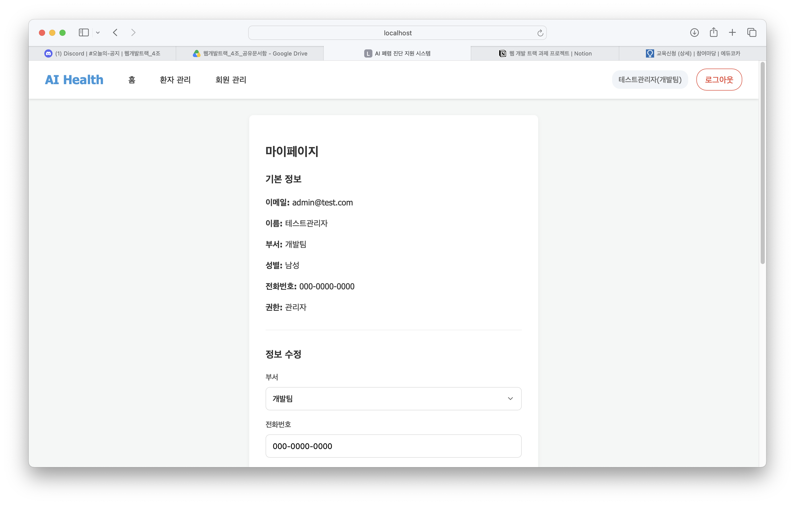
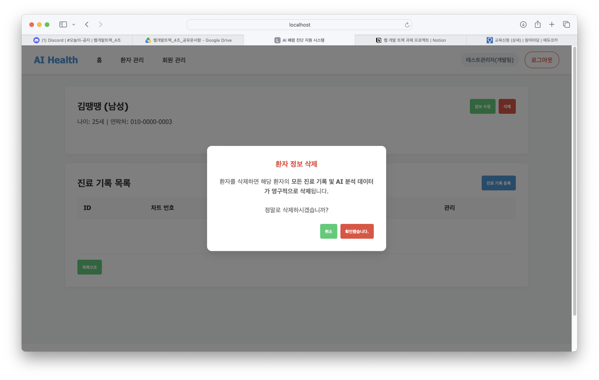
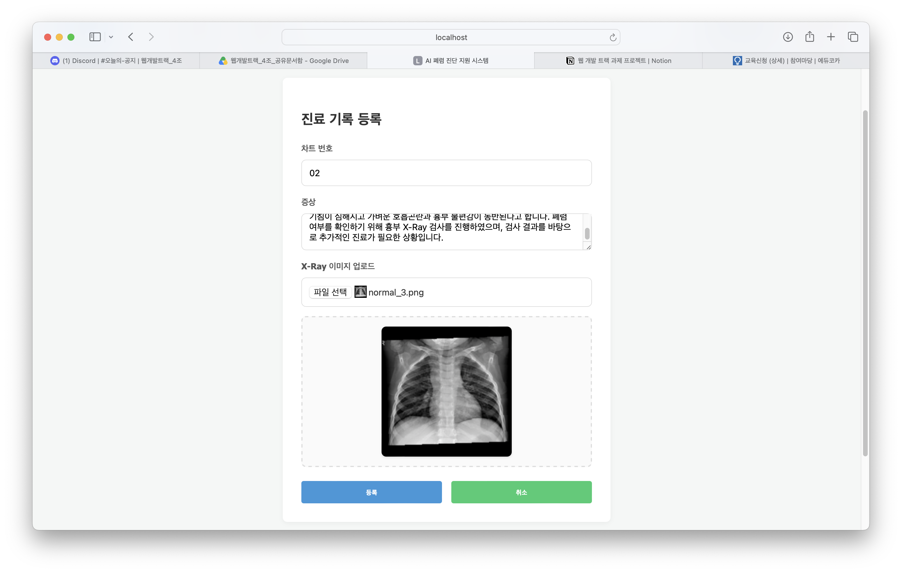
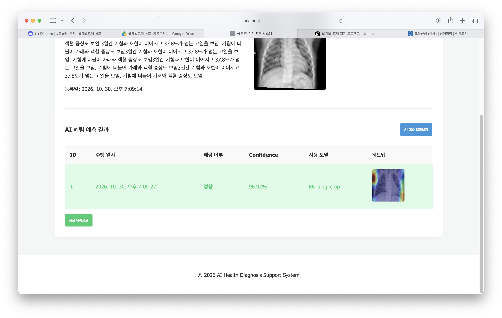

# 7일차_앱 실행화면

## 공통 안내

- 실행 방법: `fastapi run app/main.py`
- 테스트 계정: 홍시윤 님 가이드 참고
- 캡처 저장 위치: `docs/images/day7/`
- 캡처 파일명: `API이름.png`

## 1. 회원가입 (REQ-USER-001)

- 담당: 홍시윤
- API: POST /api/v1/auth/signup
- 화면 경로: /signup
- 캡처
  - 성공:
  - 실패:
- 동작 설명:

## 2. 로그인 (REQ-USER-002)

- 담당: 홍시윤
- API: POST /api/v1/auth/login
- 화면 경로: /login
- 캡처
  - 성공:
  - 실패:
- 동작 설명:

## 3. 토큰 재발급 (NFR-USER-001)

- 담당: 홍시윤
- API: POST /api/v1/auth/refresh
- 화면 경로: 
- 캡처
  - 성공:
  - 실패:
- 동작 설명:

## 4. 로그아웃 (REQ-USER-003)

- 담당: 이지희
- API: POST /api/v1/auth/logout
- 화면 경로: 
- 캡처
  - 성공:
  - 실패:
- 동작 설명:

## 5. 회원 탈퇴 (REQ-USER-009)

- 담당: 김지수
- API: DELETE /api/v1/users/me
- 화면 경로: /my-page
- 캡처
  - 성공: 
  - 실패:
- 동작 설명:회원 탈퇴 버튼을 클릭하고 확인하면 계정이 삭제되며 로그인 화면으로 이동합니다.

## 6. 마이페이지 조회 (REQ-USER-006)

- 담당: 김지수
- API: GET /api/v1/users/me
- 화면 경로: /my-page
- 캡처
  - 성공: 
  - 실패:
- 동작 설명:로그인한 사용자의 마이페이지에 이메일, 이름, 부서, 성별, 전화번호, 권한 등 기본 정보가 정상적으로 표시되는 것을 확인하였습니다.

## 7. 회원 정보 수정 (REQ-USER-007)

- 담당: 이지희
- API: PATCH /api/v1/users/me
- 화면 경로: 
- 캡처
  - 성공:
  - 실패:
- 동작 설명:

## 8. 비밀번호 변경 (REQ-USER-008)

- 담당: 이지희
- API: PATCH /api/v1/users/me/password
- 화면 경로: 
- 캡처
  - 성공:
  - 실패:
- 동작 설명:

## 9. 회원 목록 조회 (REQ-USER-004)

- 담당: 김설아
- API: GET /api/v1/admin/users
- 화면 경로: 
- 캡처
  - 성공:
  - 실패:
- 동작 설명:

## 10. 회원 권한 변경 (REQ-USER-005)

- 담당: 김설아
- API: PATCH /api/v1/admin/users/{user_id}/role
- 화면 경로: 
- 캡처
  - 성공:
  - 실패:
- 동작 설명:

## 11. 환자 정보 등록 (REQ-PTNT-001)

- 담당: 홍시윤
- API: POST /api/v1/patients
- 화면 경로: 
- 캡처
  - 성공:
  - 실패:
- 동작 설명:

## 12. 환자 목록 조회 (REQ-PTNT-002)

- 담당: 홍시윤
- API: GET /api/v1/patients
- 화면 경로: 
- 캡처
  - 성공:
  - 실패:
- 동작 설명:

## 13. 환자 정보 상세 조회 (REQ-PTNT-003)

- 담당: 이지희
- API: GET /api/v1/patients/{patient_id}
- 화면 경로: 
- 캡처
  - 성공:
  - 실패:
- 동작 설명:

## 14. 환자 정보 수정 (REQ-PTNT-004)

- 담당: 이지희
- API: PATCH /api/v1/patients/{patient_id}
- 화면 경로: 
- 캡처
  - 성공:
  - 실패:
- 동작 설명:

## 15. 환자 정보 삭제 (REQ-PTNT-005)

- 담당: 김지수
- API: DELETE /api/v1/patients/{patient_id}
- 화면 경로: /patients/2
- 캡처
  - 성공: 
  - 실패:
- 동작 설명:환자 상세 화면에서 삭제 버튼을 클릭하면 삭제 확인창이 나타납니다. 삭제 시 해당 환자의 진료기록과 AI 분석 데이터도 함께 삭제된다는 안내가 표시됩니다. 사용자가 삭제를 확인하면 환자 정보가 삭제됩니다.

## 16. 진료기록 등록 (REQ-MDR-001)

- 담당: 김지수
- API: POST /api/v1/patients/{patient_id}/medical-records
- 화면 경로: /patients/1/medical-records/create
- 캡처
  - 성공: 
  - 실패:
- 동작 설명:환자 상세 화면에서 진료 기록 등록 버튼을 클릭한 후 차트 번호, 증상, X-Ray 이미지를 입력하여 진료기록을 등록하였습니다. 등록 완료 후 환자의 진료기록 목록에 새로운 기록이 정상적으로 추가되는 것을 확인하였습니다.

## 17. 진료기록 목록 조회 (REQ-MDR-002)

- 담당: 김설아
- API: GET /api/v1/patients/{patient_id}/medical-records
- 화면 경로: 
- 캡처
  - 성공:
  - 실패:
- 동작 설명:

## 18. 진료기록 상세 조회 (REQ-MDR-003)

- 담당: 김설아
- API: GET /api/v1/medical-records/{record_id}
- 화면 경로: 
- 캡처
  - 성공:
  - 실패:
- 동작 설명:

## 19. AI 폐렴 예측 (REQ-PRED-001)

- 담당: 홍시윤
- API: POST /api/v1/medical-records/{record_id}/predictions
- 화면 경로: 
- 캡처
  - 성공:
  - 실패:
- 동작 설명:

## 20. 예측 결과 목록 조회 (REQ-PRED-002)

- 담당: 김지수
- API: GET /api/v1/medical-records/{record_id}/predictions
- 화면 경로: /medical-records/2
- 캡처
  - 성공: 
  - 실패:
- 동작 설명:진료기록 상세 화면에서 AI 폐렴 예측 결과 목록을 조회하였습니다. 예측 결과의 폐렴 여부, 신뢰도, 사용된 AI 모델명 및 히트맵 이미지가 정상적으로 표시되는 것을 확인하였습니다.

